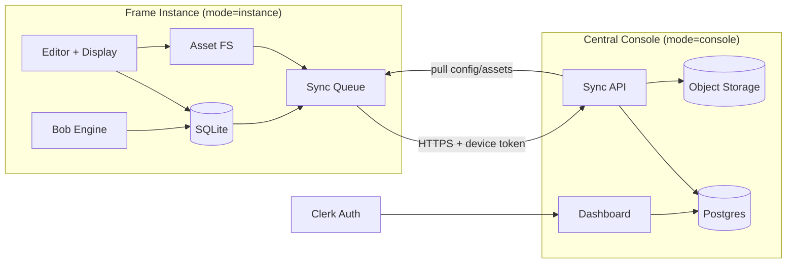

# Local-First Multi-Frame Platform — Design Spec

- **Date:** 2026-10-19
- **Status:** Draft for review (no code changes yet)
- **Scope:** Master architecture spec + staged implementation plan. Local-first Frame instances + central fleet management console + synchronization.
- **Source of truth for current state:** `docs/superpowers/specs/` + `docs/superpowers/plans/` (Bob engine lineage) and the repository audit below.

---

## 1. Summary

Frame becomes a **local-first platform**: each Frame instance is an independently useful, persistent, self-contained application running on its own device. A single codebase runs in two modes — `instance` (on a kiosk/display device, backed by local SQLite) and `console` (central server, backed by Postgres). The central console (evolved from the existing dashboard) provides fleet-wide visibility, registration, configuration rollout, and synchronization coordination, without assuming continuous connectivity or uniform capabilities.

The local instance is the authoritative owner of its runtime and locally-authoritative data; the central server coordinates instances and manages only the data/policies explicitly designated central or shared. Local-first is an architectural property, not a cache.

## 2. Goals and non-goals

### Goals
1. A Frame instance runs locally, retains data/settings/files/assets across restarts, and works offline for all functionality not inherently remote.
2. Reliable local persistence with migrations, backups, restore, crash recovery.
3. Clear data-ownership model (local / central / replicated / instance-config / shared-config / derived).
4. Durable, idempotent, resumable sync with conflict detection and explicit resolution policies.
5. Multi-frame management console: register, monitor, configure, upgrade, decommission instances.
6. Secure boundaries: auth (Clerk), per-instance scoped credentials, encrypted transport, audit logs, revocation.
7. Operational reliability: structured logs, health checks, metrics, recovery procedures, compatibility checks.
8. Preserve existing functionality; Bob engine decisions drive display layout.

### Non-goals (this master spec / first cycle)
- Rewriting the editor or widget library.
- New artwork providers or widget types.
- Mobile-native clients (web/PWA only).
- Replacing Next.js/React stack.
- Full org/billing features (Clerk orgs can be added later).

## 3. Current architecture audit (baseline)

Grounded in repository inspection (see `docs/superpowers/specs/` lineage). Key facts:

- **Stack:** Next.js 16.3.3 App Router, React 19, TS 5.7, Tailwind 4, Drizzle + Postgres, SWR, Zod 4, nanoid.
- **Persistence:** `frame_documents` (one JSONB blob per frame), `frame_templates` (unused), `content_sources` (orphaned), `display_history`. `readStore`/`mutateStore` in `lib/store.ts` with 5s in-process TTL cache and per-frame promise serialization. Media on local FS (`.data/media`).
- **Multi-frame partial:** Frame CRUD (`/api/frames`) and display routes exist, but editor store is hardcoded to `home`; `/api/active` is home-only; no standalone dashboard page; README drift.
- **Bob engine:** sophisticated context→rules→scoring→selector in `lib/engine/*`; decisions currently published as notifications only; layout switching remains schedule-driven (`resolveDisplay`). History table shared between layout and speech modes.
- **Auth:** none. All routes open. No middleware.
- **Kiosk:** mature pure logic + CLI (`lib/kiosk/*`); sync/updates are stubs; config in `/etc/kiosk/kiosk.conf`.
- **Tests:** 29 files, ~177 cases, pure-logic only; no API/component/E2E tests; one DB integration test.
- **Assets:** local FS, 10MB upload cap, remote download from allow-listed hosts, sha1 dedup, no delete/list endpoint, no image optimization.
- **Dead code:** `frame_templates`, `content_sources`, misnamed `frame-utils.ts`, likely unused `decision-debug.tsx`.

### Baseline limitations relevant to evolution
1. Server-centric monolithic document store (no versioning/ETags; whole-document writes).
2. No offline capability (no service worker/local cache).
3. Editor cannot target non-home frames.
4. Bob decisions decoupled from display layout.
5. No auth/tenancy, no rate limiting, no CSRF.
6. Sync/update stubs; no real protocol.
7. Media not backed up or shared.

## 4. Target architecture

### 4.1 Two modes, one codebase

Mode selected by `FRAME_MODE=instance|console` (default `console` for backward compat with hosted deployments).

| Concern | Instance mode | Console mode |
|---|---|---|
| Database | Local SQLite file (`DATA_DIR/frame.db`) | Postgres (existing) |
| Auth | Device token + local admin PIN | Clerk users/orgs |
| Dashboard | Read-only status page (device health) | Full fleet console |
| Sync | Outbound client (push/pull) | Inbound server (accept sync) |
| Media | Local FS + sync queue | Object storage (S3/R2) + DB metadata |
| Bob engine | Runs locally (decisions drive display) | Optional preview/simulation |

Shared code: domain types, validation, editor, display renderer, engine, kiosk CLI. Mode-specific: DB driver (Drizzle sqlite vs pg), auth middleware, sync role, storage adapter.

### 4.2 Instance lifecycle

States: `uninitialized → initializing → running → degraded → stopping → stopped`. Managed by a small lifecycle module (`lib/lifecycle/*`).

- **Install:** create data dir, init SQLite, run migrations, seed default frame (`home`), generate instance identity + device token, write config.
- **Startup:** open DB, run pending migrations, recover interrupted writes (WAL checkpoint), start health server, start sync worker (if enabled), start Bob engine timer.
- **Shutdown:** stop sync worker, checkpoint DB, close pool, flush logs.
- **Recovery:** on crash, next startup detects incomplete migration/transaction and rolls back to last checkpoint; backup snapshot retained.

### 4.3 Console (multi-frame management)

Evolves `/frame` route into a real dashboard (currently renders display). Capabilities:
- Register/discover instances (manual token entry or LAN discovery later).
- Per-instance card: identity, version, connectivity, health, last sync, pending changes, errors.
- Frame-specific settings viewer/editor (push config).
- Sync status, queue depth, failures, retry.
- Onboarding wizard, maintenance, upgrades, decommission, remove.
- Distinguish local-controlled vs central-managed vs overridable settings.

### 4.4 Bob engine drives display

`FrameDisplay` consumes `/api/display/state` decision and renders the selected layout; schedule becomes a fallback when no rule matches or experiences disabled. Notification-mode speech still publishes as notifications, but layout-mode and speech-mode history are separated (see §5.3). Hysteresis preserved.

## 5. Data ownership model

### 5.1 Categories

| Category | Authoritative source | Permitted writes | Sync direction | Conflict policy | Deletion |
|---|---|---|---|---|---|
| Locally owned data (layouts, albums, widget content created on device) | Instance | Instance only | Push (instance→console, optional) | N/A (owner writes) | Instance deletes; tombstone synced |
| Centrally managed data (shared templates, global presets, org config) | Console | Console only | Pull (console→instance) | Console wins; local draft rejected | Console tombstone |
| Replicated data (selected frames' documents for backup/visibility) | Instance (primary) + Console (replica) | Instance | Push + ack | Version/revision compare; instance wins for local-owned fields | Tombstone both sides |
| Instance-specific config (resolution, location, timezone, night mode, standby) | Instance | Instance | Optional push (read-only in console) | Instance wins | Instance |
| Shared config (branding, allowed providers, feature flags) | Console | Console | Pull | Console wins; local override only where policy allows | Console |
| Derived/transient (caches, weather, history, sync queue) | Each side locally | Local | None | Regenerate | Local |

### 5.2 Versioning & conflict detection

Every mutable entity carries:
- `entityId` (stable)
- `revision` (monotonic integer per entity, incremented on write)
- `updatedAt` (wall clock, informational only)
- `updatedBy` (instanceId or `console`)
- `contentHash` (sha256 of canonical JSON)

Conflicts detected when both sides' revisions diverge from last common checkpoint. Resolution:
- For single-owner categories: owner wins; non-owner write rejected with `409 Conflict` + current revision.
- For replicated documents: field-level merge where safe (e.g., settings vs content); otherwise create conflict record requiring manual resolution in console.
- Never silent last-write-wins on important data; always record conflict.

### 5.3 History decoupling

Split `display_history` into two tables/logical partitions: `layout_decisions` and `speech_decisions`, each with own retention and scoring inputs. Layout-mode scoring reads only layout decisions; speech-mode reads only speech. Prevents speech publications from penalizing layout novelty.

## 6. Local persistence (instance)

- **Engine:** SQLite via Drizzle (`better-sqlite3` or `libsql`). WAL mode for crash safety. Single file `DATA_DIR/frame.db` + `-wal`/`-shm`.
- **Schema:** port existing tables to SQLite; add `sync_queue`, `sync_checkpoints`, `instances` (console only), `revisions`, `conflicts`, `audit_log`.
- **Migrations:** versioned SQL in `drizzle/` (sqlite dialect) + a runner invoked at startup; each migration wrapped in transaction; backup snapshot before migration.
- **Backups:** on-demand + scheduled snapshot to `DATA_DIR/backups/<timestamp>.db` (rotated, max N). Restore via CLI/API with validation.
- **Crash recovery:** WAL + `PRAGMA integrity_check` on startup; if corrupt, restore latest backup and log.
- **Cache:** keep in-process TTL cache but invalidate on writes; multi-process not supported (single instance process).

## 7. Asset management

### 7.1 Storage & identifiers
- Assets stored under `DATA_DIR/assets/<type>/<id>.<ext>` with a registry row (`assets` table): `id`, `type`, `name`, `mime`, `size`, `hash`, `version`, `createdAt`, `updatedAt`, `refCount`, `source` (local/remote/synced).
- Stable IDs (nanoid) referenced from layouts/widgets (replace raw URLs where possible; keep URL field for remote artwork but cache locally).
- Path traversal protection: resolve and assert within `DATA_DIR/assets`.

### 7.2 Lifecycle
- Import: validate mime/size, compute hash, dedup by hash, register.
- Versioning: re-import creates new version row; old retained until refCount 0 (configurable).
- Delete: soft-delete + ref-count; hard delete when unreferenced and past retention.
- Dependency tracking: scan `FrameStore` for asset references on delete.
- Sync: push asset bytes + metadata; pull by hash; LRU cache cap to prevent unbounded growth.

### 7.3 Shared assets
- Console can publish shared asset packs; instances pull on policy; version compatibility checked; local copy retained for offline.

## 8. Synchronization architecture

### 8.1 Durable queue
- `sync_queue` table: `id`, `entityType`, `entityId`, `operation` (upsert/delete), `payload` (JSON), `createdAt`, `attempts`, `nextAttemptAt`, `status` (pending/inflight/done/failed), `idempotencyKey`.
- Survives restarts; worker runs on interval + on connectivity restore.

### 8.2 Protocol (instance↔console)
- Authenticated HTTPS, per-instance device token.
- Endpoints (console): `POST /api/sync/push` (batch changes), `GET /api/sync/pull?since=<checkpoint>` (changes + new checkpoint), `POST /api/sync/ack`.
- Idempotency via `idempotencyKey` + server-side dedup table.
- Incremental by checkpoint (cursor); full resync if instance too far behind (`410 Gone` → reset checkpoint).
- Conflict response includes both versions; instance records conflict for console resolution.

### 8.3 Policies
- Sync only categories permitted by ownership/replication policy.
- Retry with exponential backoff + jitter (reuse `nextRetryDelay`).
- Checkpoints stored locally and server-side.
- Deletion/renaming/replacement represented as tombstones with version.

### 8.4 Consistency guarantees (per category)
- Local-owned: eventual consistency to console replica; no data loss on offline (queued).
- Central-managed: instance converges to console version; stale local rejected.
- Replicated: at-least-once delivery; conflicts surfaced, not silently resolved.
- Derived: never synced.

## 9. Multi-frame management console

- **Routes:** `/console` (or `/frame` repurposed) with instance list, detail, settings, sync, audit. Existing `/frame/[frameId]` display unchanged.
- **Instance identity:** `instanceId` (nanoid), `deviceToken` (hashed server-side), `version`, `capabilities`.
- **Registration:** console issues registration token; instance redeems for device token; stored in kiosk config (secret).
- **Health:** process/storage/sync; last heartbeat; version compatibility check.
- **Config rollout:** central pushes shared config with validation; instance validates and applies atomically, retains last-known-good on failure.
- **Decommission:** revoke token; instance loses access; data retained locally.

## 10. Security

- Clerk for console users; roles: `admin`, `operator`, `viewer`.
- Instance auth: scoped device tokens (HMAC-signed or opaque DB-backed), rotation, revocation.
- Transport: HTTPS only in production; instance↔console TLS.
- Authorization: per-instance ownership (user can manage only assigned instances); admin can manage all.
- Secrets: kiosk conf mode 0600; never logged; redacted in CLI/API.
- Validation: Zod at all boundaries; file mime/size; sync payload schema.
- Audit log: admin actions + config changes + revocations (who/when/what).
- Replay protection: idempotency keys + timestamps window.
- Revoked instance cannot access central resources (token check on every request).

## 11. Reliability & observability

- Structured JSON logs with request/instance context.
- Health endpoints: `/api/health` (local) + console instance health.
- Metrics: sync lag, queue depth, failures, storage usage, DB integrity.
- Recovery procedures documented: corrupt DB, interrupted migration, failed update, disk full.
- Backup/restore workflows for instance and console.
- Compatibility checks: instance version vs console API version; block sync if incompatible.

## 12. Migration strategy

### From current state
1. **DB driver abstraction:** introduce `lib/db/driver.ts` selecting sqlite (instance) vs pg (console) based on mode; keep Drizzle schema shared where possible (dialect differences).
2. **Schema port:** generate SQLite migrations; verify against Postgres schema.
3. **Data migration tool:** one-time script to export a hosted Postgres frame document into an instance SQLite seed (for kiosk migration) OR import instance into console as registered frame.
4. **Media migration:** copy `.data/media` into new asset registry; backfill asset refs.
5. **Config migration:** existing kiosk conf → new schema with device token (none yet → registration step).
6. **Backward compat:** console mode keeps serving existing hosted frames from Postgres; no breaking change to current users until migration opt-in.

### Breaking changes
- Editor store becomes frame-aware (must pass `frameId`); internal API shape changes but external routes preserved.
- `frame_templates`/`content_sources` either implemented or removed (decision: remove if unused after audit; document).
- Bob decisions drive display layout (behavior change; schedule remains fallback).

## 13. Implementation stages (with dependencies)

1. **Audit & baseline** (done) → this spec.
2. **Architecture & design** (this spec) → approved.
3. **Local-first foundation:** DB abstraction (sqlite), migrations runner, lifecycle, backups, asset registry, offline service worker, frame-aware editor.
4. **Sync engine:** queue, protocol, checkpoints, idempotency, conflict detection, reconciliation, compatibility.
5. **Multi-frame console:** dashboard, registration, health, config rollout, audit, decommission.
6. **Migration & rollout:** tools, backward-compat, docs.
7. **Verification & hardening:** tests (offline, restart, conflict, interrupted sync, storage failure, schema upgrade), security review, perf.

Dependencies: Stage 3 before 4; 4 before 5; 6 after 3-5; 7 continuous.

## 14. Testing strategy (TDD)

- Unit: pure logic (already strong) — extend for sync planning, conflict resolution, asset hashing, migration transforms.
- Integration: API routes with test DB (sqlite in-memory); auth; sync round-trip between two instances (in-process).
- Component: jsdom env for editor/display critical flows.
- Resilience scenarios: kill process mid-write; restart; offline queue; duplicate requests; concurrent updates; interrupted transfer; disk full; schema upgrade.
- Adversarial code review per task (per prior SDD pattern: `review-<range>.diff`).

## 15. Definition of done

Matches objective §10, plus:
- Instance runs locally and retains data/assets across restarts.
- Core local functionality works offline.
- Local changes durably recorded and synced when online.
- Sync retries no duplicates/loss/inconsistency.
- Conflicts detected/handled per policy.
- Multiple frames registered and managed via console.
- Console reflects health/connectivity/sync/config.
- Central config distributed with validation/rollback.
- Assets consistent across sync/backup/restore/migration.
- Auth/authorization/revocation/audit implemented and tested.
- Existing functionality preserved or changes documented.
- Tests + ops docs cover primary failures.

## 16. Deliverables

1. This spec (architecture + ownership + sync + security + migration).
2. Target architecture diagram (text/mermaid in spec appendix).
3. Prioritized implementation plan (next: invoke writing-plans).
4. Progress ledger (`.superpowers/sdd/<slug>/progress.md`).
5. ADR record (this spec + future ADRs).
6. Known limitations & risks (§17).

## 17. Known limitations & risks

- Two DB dialects increase maintenance; mitigate via shared Drizzle schema + integration tests on both.
- Clerk adds external dependency; offline console not supported (acceptable—console is central).
- SQLite single-writer; instance must be single process.
- Asset sync bandwidth for large media; need chunking/resumable uploads (phase 2).
- Conflict resolution UX for manual conflicts is deferred to Stage 5 (console) and will be specified in the Stage 5 sub-spec.
- Migration from hosted Postgres to instance requires user action; not automatic.
- No E2E test infra yet; risk of UI regressions.

## 18. Open questions

- Object storage provider for console media (S3 vs R2) — decide before Stage 5.
- LAN discovery vs manual registration token — start manual.
- Service worker caching strategy scope — Stage 3.
- Whether to keep `content_sources` feature or remove — audit usage in Stage 3.

---

## Appendix A — Mermaid target architecture

## Appendix B — Data ownership quick reference

(See §5.1 table.)

---

*End of spec. Pending user review.*
