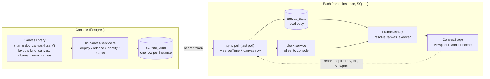

# Multi-Frame Canvas: Design Spec

- **Date:** 2026-11-24
- **Status:** Ready for implementation (no code changes made yet)
- **Baseline:** `main` at commit `a245f44` (Scale frame notifications to the frame, not the browser window, #54)
- **Scope:** A new **Canvas layout** type and a new **Canvas album** type. A console manages several frames as one continuous display. Content (text marquee, bouncing logo, Pong, and more) is aware of which frame it is on, so motion stays continuous across frames.

## How to use this spec

This document is written for a coding agent (OpenCode) working in this repo.

1. Read sections 5 (repo baseline) and 21 (pitfalls) first. They list facts about the current code that change how the feature must be built.
2. Follow `AGENTS.md`: work in a fresh worktree from `origin/main`, use the service-layer structure (`/code-structure`), prove changes with evidence (`/evidence-driven-testing`), and open one PR per phase (section 19).
3. `AGENTS.md` warns that this Next.js version has breaking changes. Read the relevant guide in `node_modules/next/dist/docs/` before writing route handlers or pages.
4. If something here conflicts with the code, the code wins for existing behavior and this spec wins for new behavior. Record the difference in the PR description instead of silently choosing.
5. Prose that a person will read (docs, PR text, code comments) goes through `/unslop`.

Naming note: the repo already has `components/editor/canvas.tsx`, the widget-editing surface. It is unrelated. In this spec "canvas" means the multi-frame surface. Code lives under `lib/canvas/`, `components/frame/canvas/` and `components/editor/canvas-admin/` so the two never mix.

---

## 1. Summary

A **canvas** is a virtual surface larger than one screen. Several frames are placed on it, each showing the window of the canvas that sits under it. A **canvas album** is a playlist of **scenes** (marquee, bouncing logo, Pong, sync test, and so on) that draw onto the canvas. A **canvas layout** says which frames are on the canvas and where.

The core idea: every scene is a **pure function of synchronized time**. Given the scene config, a seed, the canvas size and a timestamp, it returns the full state of the scene (where the logo is, where the ball is, what the score is). Every frame computes the same state from the same clock and draws only the part that falls inside its own window. No frame talks to another frame while it plays. That gives continuity across bezels by construction, survives network loss, and lets a frame that reboots or joins late fall straight back into sync.

Example: three portrait frames (1080 x 1920 each) in a row form a 3240 x 1920 canvas. A text marquee moves right to left across all three. Frame 1 shows canvas x from 0 to 1080, frame 2 from 1080 to 2160, frame 3 from 2160 to 3240.

## 2. Goals and non-goals

### Goals

1. New **Canvas layout** type and **Canvas album** type that follow the existing layout and album management flows (list, create, open, edit, duplicate, delete, import/export, "use on layout").
2. A canvas spans the frames added to it and is managed from the console.
3. Add and remove frames on a canvas at any time, including while it is live.
4. Every frame on a canvas is identifiable by its id and by a simple marker (1, 2, 3, ...). Frames can be arranged in a **row** or a **column**, with configurable positions.
5. Content is frame-aware. It does not need to scale, but it must be continuous across frames.
6. Ship these scenes in phase 1: text marquee, bouncing logo (DVD screensaver style), Pong, and a sync-test pattern. Define a registry so more scenes are cheap to add (catalog in section 10.7).
7. Robust in practice: a console operator can see whether each frame is in sync, frames keep playing in sync if the network drops, and a late or rebooted frame re-syncs by itself.

### Enhancements beyond the brief (kept inside the core idea)

- **Sync test scene** and **Identify** overlay for setup and calibration.
- **Scheduled go-live** with a lead time so all frames switch at the same instant.
- **Per-frame health** in the console: applied revision, clock quality, last seen.
- **Template layouts** with unassigned slots, and `grid` arrangement in addition to row and column.
- **Bezel gap** setting so motion looks physically continuous across screen borders.
- A **multi-window dev harness** so the feature can be demonstrated and tested without several kiosks.
- Optional timed release (`releaseAt`), logo tinting, corner-hit celebration, trails.

### Non-goals (this cycle)

- Frame-to-frame networking at playback time (no WebSocket mesh, no master/follower).
- Video or audio playback on the canvas.
- Physically rotated frames inside a canvas (a per-slot `rotation`). Reserved for a later phase.
- Replacing the existing layout editor, widget library or albums.
- Changing kiosk installer behavior.

## 3. Terms

| Term | Meaning |
|---|---|
| Frame | One screen. On the console it is an instance id plus a frame document. A kiosk runs exactly one frame, locally named `home`. |
| Canvas | The shared surface. Coordinates are **canvas px (cpx)**. |
| Slot | A frame's place on a canvas: its rectangle in cpx plus its marker. |
| Marker | The visible number (1, 2, 3, ...) of a slot. Derived from slot order, never stored separately. |
| Canvas layout | Authoring object: arrangement, slots, display options, and the id of a canvas album. Lives in the canvas library. |
| Canvas album | Authoring object: ordered scenes plus playback options. Lives in the canvas library. |
| Scene | One program in an album (marquee, bounce, pong, ...). |
| Canvas library | A reserved console-only frame document (`canvas-library`) that stores canvas layouts and canvas albums so the existing CRUD flows can be reused. |
| Deployment | A snapshot of a canvas layout plus its album, delivered to member frames with an `effectiveAt` time. |
| Canvas state | Per-frame row delivered by the console: its active deployment, its pending deployment, and an identify request. |
| Synced time | Console epoch milliseconds, as estimated on each frame (section 9). |

## 4. Design principles

1. **One world, many windows.** Scenes draw in canvas coordinates. A frame translates its window to the origin and clips. A scene never knows or cares which slot it is drawn in, except through an explicit `slot` context used for frame-aware features (markers, per-frame captions).
2. **Pure functions of time.** No scene keeps state between frames. `state = f(config, seed, bounds, sceneTimeMs)`. A dropped animation frame loses nothing: the next one computes the right position.
3. **No runtime dependency between frames.** Playback needs only the deployment snapshot and a clock.
4. **Deterministic inputs only.** No `Math.random`, no measured DOM sizes, no per-device values in the state function. Text length is measured once at authoring time and stored (section 10.3).
5. **Console is authoritative for canvas data.** Frames never push canvas state. This matches the "centrally managed data" category in `2026-10-19-local-first-multi-frame-platform-design.md` section 5.1.
6. **Reuse before inventing.** Reuse `mutateStore`, `layoutInputSchema`-style validation, `requireHostedOperator`/`resolveActor`, `audit`, `checkLimit`, SWR hooks, editor controls and the drawer pattern.
7. **Fail visible, stay running.** Anything that stops a frame from joining (clock not ready, bad data) shows a clear state on that frame and in the console. A frame never crashes the display loop.

## 5. Repo baseline and constraints

These are facts from reading the code at `a245f44`. The design depends on them.

### Frames, instances and sync

- A kiosk (instance mode, SQLite) manages exactly one frame, `home`. On the console (Postgres) its document is keyed by the instance id. `lib/sync/ids.ts` translates `home` to `INSTANCE_ID` at the sync boundary. `app/api/frames/route.ts` refuses other local frames when `INSTANCE_ID` is set.
- `lib/sync/worker.ts` runs a sync cycle every `SYNC_INTERVAL_MINUTES` (default **15**, minimum 1). A 15 minute delay is far too slow for canvas control, so this spec adds a fast poll (section 13.4).
- `GET /api/sync/pull` returns only the caller's own `frame_document`, filtered by bearer token (`lib/sync/server.ts` `handlePull`). `pullRemote` in `lib/sync/client.ts` replaces the whole local `home` document with the console payload.
- `POST /api/instances/[id]/config` is the existing "push shared config" path. It writes the member's frame document through `mutateStore`.
- API version is `1.0` (`lib/sync/compat.ts`). `checkCompatibility(instance, console)` requires the same major and `instance.minor <= console.minor`. **Do not bump the version.** A new kiosk on version 1.1 would be refused by an old console. Add new request and response fields as optional.

### Rendering

- Frame logical size is `FRAME_WIDTH` x `FRAME_HEIGHT` = 1080 x 1920 (`lib/types.ts`). `FrameDisplay` scales that to the viewport with `useViewportScale`. The `resolution` setting (`1080x1920` or `1440x2560`) does not change the logical size used by `FrameScene`.
- `FrameDisplay` polls `/api/store?frame=` and `/api/display/state?frame=` every 3 s. `useNow` ticks every 1 s. Neither is suitable for animation. Canvas playback needs its own `requestAnimationFrame` loop.
- Layout choice today: `FrameDisplay` uses the Bob decision layout if present, else `resolveDisplay` (schedule), else `activeId`.
- Albums render through `components/frame/album-slideshow.tsx`, dispatched by `slideshow.presentation`. `mosaic` and `reveal` already follow the "pure function of wall-clock plus seed" pattern in `lib/mosaic.ts` and `lib/reveal.ts`. Reuse `hash01` and `seedFromString` from `lib/mosaic.ts`.

### Types and validation

- `AlbumTheme`, `Presentation` and their metadata maps (`THEME_META`, `PRESENTATION_META` in `lib/albums.ts`) are `Record<...>` types. Adding a union member forces new map entries at compile time.
- `lib/schema.ts` uses zod 4 `z.object`, which **strips unknown keys**. A new field that is not added to the schema is silently dropped on every PUT.
- `albumUpdateSchema` limits `items` to 200 and `albumItemSchema` requires an `image` that starts with `/` or `https://`. Canvas albums have no artwork items, so they need a separate `scenes` array.
- `layoutSettingsSchema.background` already accepts `data:image/` URIs up to 3 MB. This is the precedent for embedding a small image in a document that must travel to kiosks.
- Uploads (`app/api/uploads`) are written to the **console's** `FRAME_DATA_DIR` and served from `/api/uploads/<name>` on the same origin. A kiosk loads pages from its own local origin, so an upload on the console is not available on a kiosk. Canvas logos must therefore be embedded as data URIs.

### Persistence

- `readStore` only seeds the `home` frame. Other frames must already exist.
- `mutateStore` serializes writes per frame and, in SQLite mode, enqueues a sync change.
- DB schema lives in two files that must stay in step: `lib/db/schema.pg.ts` and `lib/db/schema.sqlite.ts`. `getTables()` types both as the pg shape. Postgres migrations are generated by drizzle-kit into `drizzle/`. SQLite DDL is a list of statements in `drizzle/sqlite/0000_init.sql`, each hashed and applied once by `lib/db/migrate.ts`, so new statements are appended there.

### Auth

- Console operator routes use `resolveActor` (`x-admin-token` or Clerk). Editor write routes use `requireHostedOperator`. Device bearer tokens only authenticate `/api/sync/*` (`authenticateInstance`).
- `audit(actor, action, targetType, targetId, details)` writes the audit log.
- `lib/rate-limit.ts` `checkLimit(key, max, windowMs)` is the limiter. `clientKey(request)` returns the constant `local` unless `TRUST_PROXY` is set.

### Testing

- Vitest, `environment: 'node'`, no jsdom. Pure logic tests live in `lib/**/__tests__/`. UI wiring is asserted at the source level in `tests/*.test.ts` (read the file, match patterns). Route tests use `NextRequest`, an in-memory SQLite database (`FRAME_DB_PATH=':memory:'`, `resetSqliteDb`, `runMigrations`) and the `x-admin-token` header. See `tests/config-push.test.ts`.
- Checks that must pass: `pnpm test`, `npx tsc --noEmit`, `pnpm build`.

### Hardware

- Target kiosk: Dell Wyse 3040 (Atom x5-Z8350, 2 GB RAM), Debian, **Surf** (WebKitGTK), systemd-timesyncd for time. Portrait displays are first class. Rendering must stay light (section 17).

## 6. Architecture overview



Data flow:

1. The operator builds a canvas layout and a canvas album in the library, using editor panels that call the existing `/api/layouts` and `/api/albums` routes with `?frame=canvas-library`.
2. **Go live** calls `POST /api/canvas/deploy`. The service validates, builds one deployment snapshot per member, and writes one `canvas_state` row per member in a single transaction. Each snapshot carries `effectiveAt`, a few seconds in the future.
3. Each kiosk pulls (fast poll), stores the row locally, and `FrameDisplay` evaluates `resolveCanvasTakeover` against synced time. When synced time reaches `effectiveAt`, every frame switches at the same instant.
4. During playback each frame runs a `requestAnimationFrame` loop: `t = syncedNow - effectiveAt`, find the scene, compute scene state, draw the slice.
5. Kiosks report applied revision, clock quality, viewport and fps back on their next pull. The console shows it.

## 7. Data model

Add domain types to `lib/types.ts` (the repo's central domain model). Engine code lives in `lib/canvas/`.

### 7.1 Layout and album extensions

```ts
// lib/types.ts
export const ALBUM_THEMES = ['movies', 'tv', 'books', 'music', 'photos', 'canvas'] as const
export const PRESENTATIONS = ['fill', 'poster', 'book', 'vinyl', 'gallery', 'mosaic', 'reveal', 'canvas'] as const

export type LayoutKind = 'frame' | 'canvas'

export type Layout = {
  id: string
  name: string
  kind?: LayoutKind          // undefined means 'frame' (every legacy document)
  canvas?: CanvasConfig      // present if and only if kind === 'canvas'
  widgets: Widget[]          // always [] for canvas layouts in phase 1
  settings: LayoutSettings   // settings.albumId points at a canvas album
  createdAt: string
  updatedAt: string
}

export type Album = {
  // ...existing fields
  scenes?: CanvasScene[]     // present if and only if theme === 'canvas'; items is [] in that case
}

export type Slideshow = {
  // ...existing fields
  canvas?: { crossfadeMs: number }   // dip-to-background time at scene boundaries, 0..3000
}
```

Invariant (validated in zod, section 7.6): `theme === 'canvas'` if and only if `slideshow.presentation === 'canvas'` if and only if `scenes` is defined and `items` is empty.

Reuse existing album fields for canvas albums: `slideshow.order` (`sequence` or `shuffle`) controls scene order. `slideshow.interval` is unused for canvas albums (store `30`). `slideshow.transition` must be `none`.

### 7.2 Canvas config (on the layout)

```ts
export type CanvasArrangement = 'row' | 'column' | 'grid'

export type CanvasSlot = {
  id: string                       // stable id (nanoid 8). Survives reorder, remove of others, frame swap.
  frameId: string | null           // console frame identifier (= instance id). null = unassigned placeholder (templates).
  label?: string                   // optional human label, max 40 chars
  offset: { x: number; y: number } // cpx nudge applied after arrangement. Default 0,0.
  scale: number                    // cpx per logical frame px, 0.25..4. Default 1. Window size = 1080*scale x 1920*scale cpx.
}

export type CanvasConfig = {
  arrangement: CanvasArrangement
  gridColumns?: number             // grid only, 1..8
  gap: number                      // cpx between neighbouring slots, 0..600. Models the screen bezel.
  align: 'start' | 'center' | 'end'// cross-axis alignment for row and column
  slots: CanvasSlot[]              // order defines marker: marker = index + 1
  background: string               // hex, default '#000000'
  markers: 'identify' | 'always' | 'never'   // default 'identify'
  notifications: 'suppress' | 'show'         // default 'suppress'
  nightMode: 'inherit' | 'ignore'            // default 'inherit'
  maxFps: 15 | 24 | 30 | 60                  // default 30
}
```

Marker rule: `marker = slotIndex + 1`. Reordering or removing a slot renumbers markers. There is no stored marker field.

### 7.3 Scenes

```ts
export type CanvasSceneType = 'marquee' | 'bounce' | 'pong' | 'sync-test'
// phase 4 adds: 'panorama' | 'starfield' | 'matrix-rain' | 'bouncing-balls' | 'fireworks' | 'game-of-life' | 'wall-clock' | 'countdown' | 'gradient-flow'

export type CanvasSceneBase = {
  id: string            // nanoid 8
  name: string          // 1..60 chars
  enabled: boolean
  durationSec: number   // 5..86400
  seed: number          // int32; the editor assigns a random one on create. Never regenerated at playback.
}

export type CanvasScene =
  | (CanvasSceneBase & { type: 'marquee'; config: MarqueeConfig })
  | (CanvasSceneBase & { type: 'bounce'; config: BounceConfig })
  | (CanvasSceneBase & { type: 'pong'; config: PongConfig })
  | (CanvasSceneBase & { type: 'sync-test'; config: SyncTestConfig })
```

#### MarqueeConfig

```ts
export type MarqueeConfig = {
  lines: string[]                // 1..200 lines, each 0..300 chars
  layout: 'line' | 'block'       // 'line': lines joined by `separator` into one strip. 'block': lines stacked (vertical directions only).
  separator: string              // for 'line', default '   •   ', max 20 chars
  direction: 'left' | 'right' | 'up' | 'down'   // direction the content travels
  orientation: 'upright' | 'rotated'            // 'rotated' applies to vertical + 'line' only
  speed: number                  // cpx per second, 20..4000, default 240
  repeat: boolean                // true: loops forever. false: one pass, then empty until the scene ends
  gap: number                    // cpx between repeats, 0..20000, default 600
  lineHeight: number             // cpx, block layout, 16..1600
  align: 'start' | 'center' | 'end'  // cross-axis position of the strip or block
  crossOffset: number            // cpx, -4000..4000
  style: WidgetStyle             // reuse: font, weight, color, fill, stroke, shadow (textEffectCss)
  strip: MarqueeStrip            // measured by the editor on save, see 10.3
}

export type MarqueeStrip = {
  lengthPx: number               // total strip length along the travel axis, cpx
  crossPx: number                // strip thickness across the axis, cpx
  segments: { text: string; at: number; w: number }[]  // <= 400. at = offset along the axis, w = measured width
}
```

Direction must match the arrangement: `row` allows `left` or `right`, `column` allows `up` or `down`, `grid` allows all four. Changing the arrangement coerces an invalid direction to the default (`left` for row, `up` for column) and shows a notice. The save path (server) re-coerces and never rejects for this reason.

#### BounceConfig (DVD style)

```ts
export type BounceLogo =
  | { kind: 'text'; text: string; shape: 'none' | 'ellipse' | 'pill' | 'rounded'; style: WidgetStyle; w: number; h: number }
  | { kind: 'image'; src: string; w: number; h: number }   // src must be a data:image/png|webp|jpeg URI <= 200 KB

export type BounceConfig = {
  logo: BounceLogo
  speed: number                  // cpx/s, 40..3000, default 280
  angleDeg: number | null        // 5..85 from the horizontal axis, or null to derive from the seed
  startMode: 'seed' | 'center'
  tint: { mode: 'cycle' | 'fixed' | 'none'; colors: string[]; fixed: string }  // colors: 2..12 hex
  cornerCelebration: boolean     // default true
  trail: { enabled: boolean; length: number; spacingMs: number }   // phase 4. length 0..12
}
```

Logo `w` and `h` are in cpx and are **not** scaled to the canvas. Defaults: 300 x 140. The default logo is generated text (`DVD` in a bold built-in font inside an ellipse). **Do not ship the official DVD Video logo artwork.** Operators upload their own image.

#### PongConfig

```ts
export type PongConfig = {
  axis: 'auto' | 'horizontal' | 'vertical'   // auto: play along the longer canvas dimension
  paddle: { w: number; h: number; inset: number }  // cpx. defaults 24, 220, 40
  ballSize: number               // cpx, default 28
  baseSpeed: number              // cpx/s target average ball speed, default 900
  rallyHits: [number, number]    // min and max paddle contacts per point, default [2, 7]; max >= min + 1
  pointsPerMatch: number         // 3..21, default 7
  serveDelayMs: number           // default 900
  pointPauseMs: number           // default 1200
  showScore: boolean
  colors: { ball: string; paddles: string; net: string; text: string }
  scoreStyle: WidgetStyle
}
```

#### SyncTestConfig

```ts
export type SyncTestConfig = {
  periodSec: number              // time for the sweep bar to cross the canvas, 1..60, default 4
  showGrid: boolean              // 100 cpx grid with labels
  showBezels: boolean            // draw the gap regions between slots
}
```

### 7.4 Canvas state (per frame, delivered by the console)

```ts
export type CanvasDeployment = {
  canvasId: string               // library layout id
  name: string
  revision: number               // per-canvas monotonic deployment revision
  effectiveAt: number            // epoch ms in console time. Also the scene timeline origin.
  releaseAt: number | null       // epoch ms. After this the deployment no longer takes over.
  slotId: string                 // this frame's slot
  config: CanvasConfig           // full config, so every member holds the full geometry
  album: { id: string; name: string; scenes: CanvasScene[]; order: 'sequence' | 'shuffle'; crossfadeMs: number } | null
}

export type CanvasIdentify = {
  until: number                  // epoch ms console time
  canvasName: string
  frameId: string
  label: string | null
  marker: number
  count: number                  // total frames on the canvas
}

export type CanvasState = {
  v: 1
  active: CanvasDeployment | null
  pending: CanvasDeployment | null   // takes over when synced time >= pending.effectiveAt
  identify: CanvasIdentify | null
}
```

Table (both dialects), one row per instance, same shape on console and kiosk:

```ts
// canvas_state
instanceId: text PK
revision: integer not null default 0         // bumped on every console write for this instance
data: json/jsonb not null                    // CanvasState
updatedAt: timestamp not null
// status columns, written only on the console from kiosk reports (null on kiosks)
reportedRevision: integer null               // revision the display actually applied
clockOffsetMs: real null
clockUncertaintyMs: real null
viewportW: integer null
viewportH: integer null
fpsAvg: real null
reportedAt: timestamp null
```

Add to `schema.pg.ts` (and the `databaseSchema` object), `schema.sqlite.ts`, a drizzle-kit migration in `drizzle/`, and a `CREATE TABLE IF NOT EXISTS` statement appended to `drizzle/sqlite/0000_init.sql`. Extend `lib/db/__tests__/schema.sqlite.test.ts` to cover it.

### 7.5 Canvas library

The library is a normal frame document with the reserved identifier `canvas-library` (constant `CANVAS_LIBRARY_ID` in `lib/canvas/library.ts`). Its `FrameStore` holds:

- `layouts`: canvas layouts (`kind: 'canvas'`), the only place they exist.
- `albums`: canvas albums (`theme: 'canvas'`), the only place they exist.

The library is console-only. It is created on demand by `ensureCanvasLibrary()` (an empty store: `layouts: []`, `albums: []`, default schedule and experiences disabled). It is never sent to a kiosk because `handlePull` filters by instance id.

Why a document and not new tables: it reuses `/api/layouts` and `/api/albums`, zod validation, revisioned persistence, backups, and the editor's data hook. The cost is a few special cases for the reserved id (listed in section 21).

### 7.6 Validation (zod, in `lib/schema.ts`, following the `mosaicSchema` and `revealSchema` precedent)

Limits:

| Item | Limit |
|---|---|
| Slots per canvas | 1..16 |
| Canvas width or height | <= 32000 cpx after geometry resolves |
| Scenes per album | 1..50 (0 allowed while editing a draft; deploy requires at least one enabled scene) |
| Scene `durationSec` | 5..86400 |
| Marquee lines / chars per line | 200 / 300 |
| Marquee `strip.segments` | <= 400, `at` non-decreasing, `at + w <= lengthPx` |
| Logo image | `data:image/(png|webp|jpeg);base64,...`, decoded size <= 200 KB |
| `settings.albumId` | 1..40 chars |

Rules (use `superRefine`):

1. `kind === 'canvas'` requires `canvas` and `widgets.length === 0` (phase 1). `kind !== 'canvas'` forbids `canvas`.
2. Slot ids are unique. `frameId` is unique among non-null values.
3. `theme === 'canvas'` iff `presentation === 'canvas'` iff `scenes` is defined. When canvas, `items` must be `[]` and `transition` must be `none`.
4. Scene ids are unique within an album. Each scene's `config` validates against its type.
5. Text style reuses `widgetStyleSchema`. Colors use the existing `hex` regex.
6. Add `scenes` and `canvas` to `albumUpdateSchema` and `layoutInputSchema` explicitly. Unknown keys are stripped otherwise.

Server-only guards in the route handlers (not in zod, because they depend on the frame id): canvas layouts and canvas albums can only be written to `frame=canvas-library`; the library only accepts canvas layouts and canvas albums (section 12.1).

## 8. Geometry

`lib/canvas/geometry.ts`. Pure, no React.

```ts
export type ResolvedSlot = {
  slotId: string; index: number; marker: number
  x: number; y: number; w: number; h: number   // cpx rectangle on the canvas
  scale: number
}
export type ResolvedGeometry = {
  width: number; height: number                 // canvas bounding box in cpx, min corner at (0,0)
  slots: ResolvedSlot[]
  gaps: { x: number; y: number; w: number; h: number }[]  // regions inside the bounding box that no slot covers between neighbours (bezels)
}
export function resolveGeometry(config: CanvasConfig): ResolvedGeometry
export function validateGeometry(g: ResolvedGeometry): GeometryIssue[]   // overlaps, too large, no slots
```

Algorithm:

1. Each slot's base size is `w = FRAME_WIDTH * scale`, `h = FRAME_HEIGHT * scale`.
2. **row:** place slots left to right. `x[0] = 0`, `x[i+1] = x[i] + w[i] + gap`. Cross-axis: `y = 0` for `start`, `(H - h) / 2` for `center`, `H - h` for `end`, where `H = max(h)`.
3. **column:** symmetric. `y[i+1] = y[i] + h[i] + gap`. Cross-axis uses `W = max(w)`.
4. **grid:** `gridColumns` columns, row-major. Cell width is the max slot `w`, cell height the max slot `h`. Slots align to the cell by `align`. Gaps apply on both axes.
5. Add `slot.offset` to each position.
6. Translate everything so the minimum `x` and `y` over all slots are 0. Width and height are the bounding box.
7. Overlap check: any pair of slot rectangles with positive intersection area is an error `E_OVERLAP`. Touching edges are fine. Width or height above 32000 is `E_TOO_LARGE`. Zero slots is `E_NO_SLOTS`.

`gaps` is used for the sync-test scene, the wall preview, and the bezel overlay. It does not affect rendering of normal scenes: objects pass behind the bezel, which is the physical behavior of a video wall.

Required properties (tests in section 18): for any config, slot rectangles are inside `[0,width] x [0,height]`; `resolveGeometry` is deterministic; reordering slots in a row never changes the bounding box size when `gap` and all `w` are equal; removing a slot renumbers markers contiguously.

## 9. Time synchronization

Continuity across frames depends on every frame agreeing on "now". The error budget:

```
visible mismatch at a bezel (px) = scene speed (px/s) * clock skew between the two frames (s)
```

| Speed | Skew 10 ms | Skew 20 ms | Skew 50 ms |
|---|---|---|---|
| 240 px/s | 2.4 px | 4.8 px | 12 px |
| 600 px/s | 6 px | 12 px | 30 px |
| 1200 px/s | 12 px | 24 px | 60 px |

Target: skew <= 20 ms on a LAN, <= 50 ms through a WAN console. The sync-test scene and the status tab exist to check this.

### 9.1 Sources

- **Reference:** the console server clock (`Date.now()` on the console process).
- **Kiosk OS clock:** disciplined by systemd-timesyncd. Good, not good enough on its own, so the app measures its own offset to the console.
- Browser and local Next server on a kiosk share one OS clock, so the **Node process measures the offset** and the browser reads it from a local route. The browser does not talk to the console.

### 9.2 Offset estimation (`lib/canvas/clock.ts`, pure)

Every sync pull is a probe. `pullRemote` records `t0` before the request and `t1` after. The pull response carries a new optional field `serverTime` (console `Date.now()` taken as late as possible before responding).

```ts
export type ClockSample = { at: number /* t1 */; rttMs: number; offsetMs: number }

export function sampleFrom(t0: number, t1: number, serverTime: number): ClockSample | null {
  const rtt = t1 - t0
  if (!(rtt >= 0 && rtt <= 3000)) return null
  return { at: t1, rttMs: rtt, offsetMs: serverTime + rtt / 2 - t1 }   // console time minus local time
}

export function estimate(samples: ClockSample[], now: number): ClockEstimate | null
// - keep samples newer than 120 s, at most the latest 16
// - among the latest 8, choose the minimum rtt sample: offsetMs = its offset, uncertaintyMs = rtt / 2
// - jitterMs = standard deviation of offsets of the 4 lowest-rtt samples
// - quality: 'good' (uncertainty <= 15 and jitter <= 10), 'fair' (uncertainty <= 50), else 'poor'
```

### 9.3 Applying the offset (browser)

`GET /api/canvas/state` returns `clock: { offsetMs, uncertaintyMs, quality, source: 'console' | 'system', sampledAt }`. The browser keeps an **applied offset** and moves it toward the target with a slew limit so frames never visibly jump:

```ts
export function slewOffset(applied: number, target: number, dtMs: number, maxRateMsPerSec = 2, stepThresholdMs = 250): number
// if |target - applied| > stepThresholdMs, return target (step).
// else move at most maxRateMsPerSec * dtMs / 1000 toward target.
```

`syncedNow() = Date.now() + appliedOffset`. The browser re-reads the clock every 10 s.

`source: 'system'` (offset 0) is used when the kiosk has never reached the console in this boot. Playback continues on the OS clock and the state is reported.

### 9.4 Startup

On boot the frame waits for the first clock estimate before drawing scenes (it shows the identify marker or a dark screen with the marker). It waits at most 10 s, then proceeds on the system clock and keeps trying.

### 9.5 Two-phase go-live

Frames never apply a deployment before `effectiveAt`. The console picks `effectiveAt` far enough ahead that every member has pulled it (section 13.3). Until then a frame keeps showing whatever it showed. At `effectiveAt` all frames start the scene timeline at `sceneTime = 0`.

A frame that receives a deployment late still computes `t = syncedNow - effectiveAt` and joins in sync mid-scene. `effectiveAt` is only the timeline origin.

### 9.6 Dev and test hooks

- `GET /api/time` returns `{ t: <console epoch ms> }`, `Cache-Control: no-store`, rate limited (`checkLimit`, 600 per minute per `clientKey`). Used by the console editor preview (the browser is its own client there) and by the dev harness.
- The dev harness accepts `?t=<epochMs>` to freeze synced time for screenshots (dev route only, never on the production display route).

## 10. Scene engine

`lib/canvas/scenes/*`. No React, no DOM, no `Math.random`, no `Date.now`.

### 10.1 Contract

```ts
export type SceneContext = {
  bounds: { width: number; height: number }     // canvas size, cpx
  geometry: ResolvedGeometry
  tMs: number                                   // scene-local time, ms since this scene started, >= 0
  seed: number                                  // scene.seed combined with the cycle number
  slot: ResolvedSlot                            // the slot being drawn. Frame awareness lives here.
}

export type SceneDefinition<TType extends CanvasSceneType, TConfig, TState> = {
  type: TType
  label: string
  description: string
  icon: LucideIcon
  defaultConfig(geometry: ResolvedGeometry): TConfig
  schema: z.ZodType<TConfig>
  fields: SceneField[]                          // drives the generic editor form (like PropField in lib/widgets.ts)
  stateAt(config: TConfig, ctx: Omit<SceneContext, 'slot'>): TState      // pure, slot independent
  // rendering is in components/frame/canvas/scenes/<type>.tsx and consumes TState plus slot
}
```

`stateAt` must not depend on `slot`. Continuity is guaranteed because every frame computes the same `TState`. The renderer then draws `TState` in canvas coordinates under the viewport transform (section 11). A scene that wants per-frame behavior (a label on each frame) does it in the renderer using `ctx.slot`, never in `stateAt`.

Registry: `lib/canvas/scenes/registry.ts` exports `SCENES` and `getSceneDefinition(type)`, following `WIDGETS` and `getDefinition` in `lib/widgets.ts`.

### 10.2 Scheduler (`lib/canvas/scheduler.ts`)

```ts
export type ScenePlan = {
  scene: CanvasScene
  index: number            // position in the enabled list
  sceneTimeMs: number      // time since this scene started
  cycle: number            // how many full album cycles have elapsed
  nextChangeAtMs: number   // absolute synced time when the scene ends
  fade: number             // 0..1 opacity multiplier from dip-to-background
}
export function sceneAt(album: DeploymentAlbum, albumSeed: number, tSinceEpochMs: number, crossfadeMs: number): ScenePlan | null
```

1. Enabled scenes only. `total = sum(durationSec * 1000)`. If `total === 0` return `null`.
2. `t < 0` returns `null` (before `effectiveAt`).
3. `cycle = floor(t / total)`, `r = t mod total`.
4. Order: `sequence` is the list order. `shuffle` uses a seeded permutation of the scene indices, seeded by `hash(albumSeed, cycle)`. The cycle length is the sum of all durations, which does not change with the permutation, so `cycle` is well defined.
5. Walk cumulative durations in that order to find the scene and `sceneTimeMs`.
6. `fade`: ramps 0 to 1 over the first `crossfadeMs` of the scene and 1 to 0 over the last `crossfadeMs` (clamped to a third of the scene length). Only one scene is drawn at a time ("dip to background"). This is cheap on weak hardware and cannot desync.
7. The scene `seed` passed to `stateAt` is `hash(scene.seed, cycle)` for shuffle albums and `scene.seed` for sequence albums, so a repeated scene looks the same every cycle in sequence mode and varies in shuffle mode.

`albumSeed` is `seedFromString(albumId + '|' + scene ids joined by ',')`, the same pattern as the mosaic.

### 10.3 Marquee

Geometry along the travel axis: `L` is the canvas length along the axis (`width` for left/right, `height` for up/down). `T = strip.lengthPx`, `G = gap`, `v = speed`, `tau = v * sceneTimeSec`, `P = T + G`.

Copy `j` (j >= 0) position of its leading edge reference:

- `left`: `x_j = L - tau + j * P`. Visible when `x_j > -T` and `x_j < L`.
- `right`: `x_j = -T + tau - j * P`.
- `up` and `down`: same with `y` and `height`; `up` uses the `left` formula, `down` uses the `right` formula.

Only integer `j >= 0` are used, so content **enters from the edge** at scene start. With `repeat: false` only `j = 0` exists. The renderer computes the range of `j` that intersects the **slot window** (not the whole canvas), which is normally 1 to 3 copies per frame:

```
left:  j in ( (tau - (slotEnd) - T) / P ... (tau - slotStart) / P )   // derived from x_j in (slotStart - T, slotEnd)
```

Implement it as a helper `visibleCopies(config, ctx): number[]` with tests, capped at 64 copies.

Authoring-time measurement (**important for determinism**): timing and positions must not depend on how a given device lays out text. The editor measures the text once with the same font and style and stores `strip`:

- For `layout: 'line'`: split the joined string into segments at spaces, each at most about 4096 cpx wide. For each segment store its measured `at` (offset along the axis) and `w`. Use canvas `measureText` plus `letterSpacing`.
- For `layout: 'block'`: no measurement. Each line is a segment at `at = i * lineHeight`, `w = lineHeight`, and `crossPx` is the canvas cross-axis length.
- The renderer places each segment at its stored `at` as an absolutely positioned, non-wrapping element and only creates elements for segments that intersect the slot window. This keeps long text from creating a single huge layer.
- Fonts: use built-in fonts (`next/font`, self-hosted, identical on every kiosk) by default. Custom `gf:` fonts need internet on every frame. The editor shows a warning and the status tab shows a "fonts not loaded" note when `document.fonts.check` fails on a frame.
- If `strip` is missing (config created through the API), the server fills it with an estimate (`chars * fontSize * 0.6`, one segment) and marks the scene `needsMeasure: true` in the editor. Never leave timing undefined.

Rotation rule: the head of the text leads the motion. `up` rotates the strip -90 degrees, `down` rotates it +90 degrees. Cross-axis placement uses `align` and `crossOffset` against the canvas cross length.

Default scene on create: lines `['Hello, wall']`, row `left`, speed 240, 160 cpx font (built-in `bebas`), `durationSec` 60.

### 10.4 Bounce (DVD style)

Let `Rx = width - logo.w` and `Ry = height - logo.h` (clamp to at least 1). The logo bounces off the **canvas bounding box** edges. Bezel gaps are inside the box, so the logo passes behind bezels and reappears, like a video wall.

```ts
export function fold(u: number, range: number): number {
  if (range <= 0) return 0
  const p = 2 * range
  const m = ((u % p) + p) % p
  return m <= range ? m : p - m
}
```

Per axis: start position `s0` in `[0, R]`, speed `v = |v_axis| > 0`, initial direction `d0 = +1 or -1`, phase `u0 = d0 > 0 ? s0 : 2R - s0`. For scene time `t` (seconds): `u = u0 + v * t`, `pos = fold(u, R)`, wall hits so far `hits = floor(u / R) - floor(u0 / R)`.

Seeded start: from `seed`, pick the quadrant signs, an `angleDeg` in `[20, 70]` if `config.angleDeg` is null (never exactly axis-aligned), `vx = speed * cos(angle)`, `vy = speed * sin(angle)`, and `s0` uniformly inside the range (`center` start uses `R/2`).

State:

```ts
type BounceState = { x: number; y: number; bounces: number; colorIndex: number; corner: { hit: boolean; ageMs: number } | null; trail: { x: number; y: number }[] }
```

- `bounces = hitsX + hitsY`.
- `colorIndex = (seedColor + bounces) % colors.length` when `tint.mode === 'cycle'`.
- **Corner hit:** compute the time of the most recent wall hit on each axis, `tx = (floor(ux) * Rx - u0x) / vx` and likewise `ty`. If both exist and `|tx - ty| <= 40 ms`, a corner hit happened at `max(tx, ty)`. `ageMs = t - that time`. The renderer plays a 1500 ms celebration when `ageMs < 1500`.
- **Trail (phase 4):** `trail[k] = state at (t - k * spacingMs)` for `k = 1..length`, clamped at `t >= 0`. This is analytic, so it needs no history.

Rendering the logo: an absolutely positioned element at `translate3d(x - slot.x, y - slot.y, 0)`. Image logos use `` with the data URI. Tinting uses `mask-image: url(dataUri)` with `background-color`, which works because data URIs are same-origin. Text logos use `textEffectCss(style)`. Only draw the logo if its rectangle intersects the slot window.

Precision: with `t` up to 86400 s and `v` up to 3000, `u` stays below 3e8, well inside double precision. Add a test at `t = 86400`.

### 10.5 Pong

Pong is **scripted deterministically**: every point has a fixed time slot, its winner and rally length come from the seed, and the ball path is analytic. It looks like a real game and needs no simulation state.

Game space: play axis length `A` and cross length `B`. With `axis: 'auto'`, `A` is the longer canvas dimension. Map game coordinates to canvas coordinates by swapping axes when the play axis is vertical (`mapGameToCanvas`).

Constants derived from config: `pw, ph, inset` (paddle), `bs` (ball). Left paddle front face `xL = inset + pw`, right paddle front face `xR = A - inset - pw`. Traversal distance `D = xR - xL - bs`. Overshoot after a miss `O = inset + pw + bs`. Vertical fold range for the ball top `Rb = B - bs`.

**Timing (`pongTiming(config, bounds)`)**, identical on every frame because it depends only on config and canvas size:

```
avgHits   = (rallyHits[0] + rallyHits[1]) / 2
pointSec  = clamp( (serveDelayMs + pointPauseMs) / 1000 + (avgHits * D + O) / baseSpeed , 4, 60 )
flightSec = pointSec - (serveDelayMs + pointPauseMs) / 1000
matchSlots = pointsPerMatch + 1           // the last slot shows the winner banner
```

`slotIndex = floor(sceneTimeSec / pointSec)`, `matchIndex = floor(slotIndex / matchSlots)`, `k = slotIndex mod matchSlots`. If `k === pointsPerMatch` this is the banner slot, otherwise point `k` of the match.

**Point plan `pointPlan(matchIndex, k)`**, from `hash(seed, matchIndex, k)`:

1. `server = k mod 2` (0 left, 1 right).
2. `winner`: seeded bit with a mild catch-up bias so scores stay close (optional; any deterministic rule is fine). `loser = 1 - winner`.
3. Rally length `n` (contacts including the final miss), from `[min, max]`. The receiver of traversal `j` is the opponent of the server for odd `j` and the server for even `j`. The loser must receive traversal `n`, so `n` must be odd if `loser === 1 - server`, even otherwise. Choose `n` uniformly from the allowed values of the right parity in range. This is why `max >= min + 1` is required.
4. Ball speed along the play axis: `vu = (n * D + O) / flightSec`. Traversal time `tau = D / vu`.
5. Cross motion: `vv = vu * tan(phi)`, `phi` seeded in `[8, 32]` degrees, seeded sign, `ballTop0` seeded in `[0.15 * Rb, 0.85 * Rb]`.

**Ball position at point-local time `s` (seconds):**

- `s < serveDelay`: ball sits on the server paddle at `(face, ballTop0)`, `vv` not applied.
- `serveDelay <= s < serveDelay + flightSec`: `a = s - serveDelay`. Along the axis the ball starts at the server's face and moves toward the opponent, reversing direction at each hit. Traversal index `j = min(n, floor(a / tau) + 1)`. For `j <= n` the position is linear within the traversal. During the final traversal the ball keeps going past the loser's face by `O`, then leaves the field. Cross: `ballTop = fold(ballTop0 + vv * a, Rb)`.
- `s >= serveDelay + flightSec`: ball hidden (pause).

Hit times: `t_j = serveDelay + j * tau` for `j = 1..n`. Contacts `j < n` are hits; contact `n` is the miss.

**Paddles.** For each side build a time-ordered event list for the point: `(time, y)`.

- Start event: the server paddle at `(0, ballCenter(serveDelay) - ph/2)` clamped to `[0, B - ph]`; the receiver at `(0, restY)` where `restY` is seeded near the middle.
- Each hit `j < n` adds `(t_j, clamp(ballCenterAtHit - ph/2, 0, B - ph))` for the receiving side.
- The miss adds `(t_n, missY)` for the loser, where the paddle ends up off the ball: `missY = clamp(ballCenter - ph/2 + sgn * (0.75 * ph + 30 + 40 * u), 0, B - ph)` with `sgn` chosen so the clamp leaves at least `0.6 * ph + bs/2` of separation (flip `sgn` if clamping removed it).

Between consecutive events of one side, `(t_a, y_a)` to `(t_b, y_b)`: hold `y_a` until `t_m = t_a + 0.25 * (t_b - t_a)`, then `y = lerp(y_a, y_b, smoothstep((t - t_m) / (t_b - t_m)))`. After the last event of the point, hold until the pause starts. During the final `pointPauseMs` of every slot (point or banner), each paddle eases from its last position to its **start position in slot `g + 1`** (computed from `pointPlan` of the next slot, which is O(1)). This makes paddle motion continuous across slots without any shared state.

**Score.** For match slot `k`, the score is the number of points won by each side among points `< k`, plus point `k` once `s >= serveDelay + n * tau` (the miss). Compute by summing `pointPlan(matchIndex, i).winner` for `i < k`. The cost is O(pointsPerMatch).

**Banner slot** (`k === pointsPerMatch`): both paddles ease to the center, the final score and "LEFT WINS" or "RIGHT WINS" text are shown (text is generated from the score, in the scene's text style). The next match starts at score 0.

**Drawing:** net (dashed line across the cross axis at `A/2`), two paddles, ball, score text near the center of the cross axis. For a mid-canvas element crossing a bezel (the net, the score), the renderer draws it at its canvas position and the viewport clips it, as for everything else.

State type:

```ts
type PongState = {
  phase: 'serve' | 'flight' | 'pause' | 'banner'
  ball: { x: number; y: number; visible: boolean }    // game space
  paddles: [number, number]                           // top y of left and right paddles, game space
  score: [number, number]
  banner: string | null
  axis: 'horizontal' | 'vertical'                     // for mapGameToCanvas
}
```

Required properties (tests): every state value is finite; ball and paddles stay inside the field; ball center at each hit time `t_j` is within `ph/2` of the receiving paddle center; at the miss it is outside the paddle; position is continuous across slot boundaries (difference at `s = pointSec - epsilon` and `s = epsilon` of the next slot stays within a small bound for paddles); results are identical for repeated calls and for different `slot` values (slot is not an input).

### 10.6 Sync test

A calibration pattern, always available:

- Dark background. A bright vertical bar (or horizontal for column canvases) sweeps the whole canvas every `periodSec` using `fold` so it runs back and forth. Position `p = fold(tMs / 1000 / periodSec * L * 2, L)`.
- Each slot is outlined and shows its marker (large), frame label or id, and slot rectangle text.
- Optional 100 cpx grid with labels, optional bezel regions drawn in a dim color (from `geometry.gaps`).
- A visible desync shows up as the bar jumping at a bezel.

New canvas albums are created with one sync-test scene so a first deploy shows something useful.

### 10.7 Scene catalog (phase 4 and later)

All of these must be pure functions of time. Items that need accumulated state use a periodic re-seed (a "round") so the state at any time is computed from at most one round of history.

| Scene | Notes on determinism |
|---|---|
| Panorama | One wide image across the canvas, fit modes `cover`, `contain`, `tile`, optional slow pan. Image is a data URI per scene (size cap applies) or a list for a slideshow. |
| Starfield | Stars are hash-derived from `(seed, index)`; position is analytic in time (`z` decreasing modulo). |
| Matrix rain | Columns hash-seeded; each column's head position is `(speed * t + offset) mod (H + tail)`. |
| Bouncing balls | N balls, each an independent `fold` per axis. Collisions between balls are not modeled. |
| Fireworks | Launch times from hash; ballistic arcs are analytic. |
| Game of Life | Generation `g = floor(t / step)`. Simulate from the round start (reseed every 600 generations), grid sized from the canvas. Cost is bounded per frame by caching one round per frame loop. |
| Wall clock | Large HH:MM:SS; digits laid across slots so each frame owns a digit group. Uses synced time and the frame timezone. Needs `slot` awareness. |
| Countdown | Days/hours/minutes to a target instant, spanning the wall. |
| Gradient flow | Slow color field using trigonometric functions of `(x, y, t)`. |
| Snake / Pac-style chase | Path is a closed analytic loop (Lissajous or rectangle) so position is a function of time. |

Each new scene is a new file under `lib/canvas/scenes/` plus a renderer and a registry entry. No other file should need to change.

## 11. Display runtime

### 11.1 Takeover resolution (`lib/canvas/takeover.ts`, pure)

```ts
export type CanvasTakeover = { deployment: CanvasDeployment; geometry: ResolvedGeometry; slot: ResolvedSlot }

export function resolveCanvasTakeover(state: CanvasState | null, nowMs: number): CanvasTakeover | null
```

1. If `state.pending` exists and `nowMs >= pending.effectiveAt`, the candidate is `pending`; otherwise `active`.
2. No candidate returns `null`. `nowMs < candidate.effectiveAt` returns `null`. `candidate.releaseAt !== null && nowMs >= releaseAt` returns `null`.
3. Resolve geometry from `candidate.config`; find the slot by `candidate.slotId`. Missing slot returns `null`.

The result does not depend on the frame's own layouts, schedule or Bob decisions. **A canvas takeover overrides them while it is live** (otherwise a per-frame schedule could break the wall). It never edits `activeId` or the schedule, so releasing needs no restore step.

### 11.2 `FrameDisplay` changes

- Fetch `GET /api/canvas/state?frame=<frameId>` with SWR (`refreshInterval: 3000`). The response contains the local `CanvasState`, its `revision`, and the `clock` estimate.
- Compute `syncedNowMs` from `useNow()` plus the slewed offset (`useCanvasClock`).
- `takeover = resolveCanvasTakeover(...)`. If present, render `<CanvasFrameScene>` instead of the layout scene.
- If `config.notifications === 'suppress'`, do not render `FrameNoticeLayer` during takeover.
- If `config.nightMode === 'inherit'`, keep the existing night overlay from `resolveDisplay(...).night`.
- Render `<IdentifyOverlay>` on top of everything when `state.identify` exists and `syncedNowMs < identify.until`, whether or not a takeover is active.
- No takeover: behavior is exactly as today.
- Ignore any Bob `decisionLayout` while a takeover is active.

### 11.3 `CanvasFrameScene` and `CanvasStage`

`CanvasFrameScene` reproduces the outer wrapper of `FrameScene` (a `FRAME_WIDTH x FRAME_HEIGHT` logical box scaled by `useViewportScale`). Inside it, `CanvasStage` renders:

```
<div class="viewport" style="position:absolute; inset:0; overflow:hidden; contain:strict; background:<config.background>">
  <div class="world" style="position:absolute; left:0; top:0; width:0; height:0;
                            transform: scale(1/slot.scale) translate3d(-slot.x px, -slot.y px, 0)">
    ...scene elements positioned in canvas coordinates...
  </div>
</div>
```

Rules:

- The world element has **no size and paints nothing**. Elements inside are absolutely positioned and created only if they intersect the slot window. Never create a div as wide as the canvas.
- Scene changes and deployment changes re-render React. The per-animation-frame update is **imperative** (refs and `style.transform`). No `setState` in the animation loop.
- Loop: `requestAnimationFrame`. Cap to `config.maxFps` by skipping frames. Each tick: `t = syncedNow() - deployment.effectiveAt`, `plan = sceneAt(...)`, `state = definition.stateAt(...)`, paint. Schedule one `setTimeout` for `plan.nextChangeAtMs` to swap scene React trees, as `MosaicSlideshow` does. Re-evaluate on `visibilitychange` and `focus`.
- Pre-roll: before the first scene starts (`t < 0`) draw the background and the marker if `markers !== 'never'`.
- Preload: decode the logo image (and `document.fonts.ready`) before the first paint of a scene. If the image fails to decode, fall back to the text logo `?` with a console warning.
- Reduced motion (`prefers-reduced-motion`): still run, because continuity is the point. Skip decorative effects (trail, corner celebration).
- Markers: `markers: 'always'` draws a small corner badge with the marker number and frame id. `identify` uses the overlay only.
- Report: every 10 s post `{ appliedRevision, viewportW, viewportH, fpsAvg }` to `POST /api/canvas/report`.

### 11.4 Identify overlay

Fullscreen, high contrast, shown for `until - now` ms: a very large marker numeral (about 55 percent of the viewport short side), under it the label or frame name and id, the canvas name, `Frame k of N`, the slot rectangle in cpx, and the clock quality. It does not depend on a deployment, so it works while arranging a draft canvas.

### 11.5 Failure and degraded states

| Situation | Behavior |
|---|---|
| No `CanvasState` or no takeover | Normal display. |
| Clock not ready | Dark screen plus marker, up to 10 s, then system clock. |
| Deployment slot missing | Normal display. Report `appliedRevision = null`. |
| Scene config invalid on this frame | Draw the background and an on-frame error line. Do not throw. Wrap the scene renderer in an error boundary. |
| Logo fails to decode | Text fallback logo. |
| Viewport aspect ratio not about 9:16 | Draw normally (letterboxed like the rest of `FrameDisplay`). Report viewport so the console can warn. |

## 12. Management flows (console)

### 12.1 Library and routes

- `GET /api/canvas/library` (operator): ensures the library document exists and returns `{ store, frames }`. `frames` lists enrolled instances for the palette: `{ id, name, lastSeenAt, inCanvas: { canvasId, name, state: 'scheduled' | 'live' } | null }`.
- Authoring uses the existing routes with `?frame=canvas-library`: `POST/PUT/DELETE /api/layouts`, `POST/PUT/DELETE /api/albums`. Route guards:
  - `kind: 'canvas'` layouts and `theme: 'canvas'` albums are accepted only when the frame id is the library, and only when `INSTANCE_ID` is unset (console runtime).
  - The library accepts only canvas layouts and canvas albums.
  - `DELETE /api/layouts/[id]` normally refuses to delete the last layout. Skip that rule for the library.
  - `POST /api/layouts` normally sets `activeId` when none is set. Skip that for the library.
  - Deleting a canvas layout that is scheduled or live is refused with 409 (`E_LIVE`). Deleting a canvas album that a canvas layout uses clears `settings.albumId` (existing behavior) and the deploy check will then fail until a new album is chosen.

### 12.2 Editor navigation

Add a **Canvas** rail item next to **Frames** in `components/editor/editor.tsx`, shown only to users with `canManageFrames` and only on the console runtime. It opens a drawer, `CanvasAdminPanel`, with three tabs (same pattern as `FrameAdminPanel`):

1. **Layouts**: list of canvas layouts, mirroring `LayoutsPanel`.
2. **Albums**: list of canvas albums, mirroring `AlbumsPanel`.
3. **Status**: per-frame health for deployed canvases.

The existing `Layouts` and `Albums` panels for normal frames do not change, except they must not list canvas types:

- `AlbumsPanel` theme chooser: use `ALBUM_THEMES.filter((t) => t !== 'canvas')`.
- `AlbumDetail` presentation picker: use `PRESENTATIONS.filter((p) => p !== 'canvas')`.

Use the data hook pattern of `useFrameStore(emptyStore, 'canvas-library')`; add `hooks/use-canvas-library.ts` wrapping it plus the frames list.

### 12.3 Canvas layouts tab (mirrors `LayoutsPanel`)

- Header buttons: **New canvas layout**, **Import** (JSON, validated by the layout schema).
- Each row: a thumbnail (`CanvasWallThumb`: a miniature of the slot rectangles with markers, drawn from `resolveGeometry`), name, "N frames - row/column/grid", edited date, and a state chip (Draft, Scheduled, Live).
- Row actions: **Go live** (or **Release** when live), **Duplicate**, **Delete** (disabled while scheduled or live).
- Opening a row shows `CanvasLayoutDetail` (section 12.5).

### 12.4 Canvas albums tab (mirrors `AlbumsPanel` and `AlbumDetail`)

- **New album** creates a canvas album with one sync-test scene (default 30 s).
- List rows show name, scene count and total cycle length ("4 scenes - 2 min 30 s per cycle"), and "Used by: <canvas layout names>".
- `CanvasAlbumDetail` (modeled on `album-detail.tsx`): name; scene list with enable toggle, duration, duplicate, delete, move up and down (and drag where the editor already supports it); **Add scene** (cards with icon and description from the registry); the selected scene's form, generated from `fields` (number, slider, text, textarea, select, color, toggle, font, style, image) with special editors for marquee text (lines plus measure-on-save) and logo upload; album options: order sequence or shuffle, crossfade; a **Preview** that plays the album on the wall preview.
- Logo upload: pick an image, downscale in the browser to at most 512 cpx on the long side, **encode as PNG or WebP (keep alpha)**, reject if the data URI exceeds 200 KB. Add a `downscaleToDataUri(file, maxDim, mime)` helper next to `downscaleImage` in `lib/frame-utils.ts` (the existing function re-encodes JPEG and drops alpha).
- Marquee save: measure with `lib/canvas/measure-client.ts` (browser only) using the selected font and style, and store `strip`. Block layout needs no measurement.

### 12.5 Canvas layout detail (arrangement editor)

Sections, top to bottom:

1. **Header**: editable name, state chip, buttons **Go live** / **Update live canvas** / **Release**, **Identify frames**, **Sync test**.
2. **Arrangement**: segmented control Row | Column | Grid; for grid a columns field; **Gap** slider (0 to 600 cpx, labelled "Bezel gap"); **Align** (start, center, end).
3. **Frames** (the add and remove mechanism):
   - Ordered list. Each item: marker badge (large, text not color only), frame select (name and id), status dot (online by `lastSeenAt`, applied revision, clock quality), buttons **Move earlier** and **Move later** (keyboard accessible; drag is optional), **Remove**, and a collapsed **Fine position** group with offset x and y and scale.
   - **Add frame**: a select listing enrolled frames not on this canvas. A frame that is on another scheduled or live canvas is shown disabled with that canvas's name.
   - **Add empty slot**: adds a placeholder (`frameId: null`) so a layout can be a template. Placeholders are assigned later with the item's frame select.
   - Removing the last slot is allowed (draft). A live canvas must keep at least one assigned slot.
4. **Album**: a select of canvas albums, with a **Manage albums** link that switches the drawer tab (same pattern as `LayoutSettingsPanel`'s Slideshow section).
5. **Display**: background color, markers (Identify only, Always, Never), notifications (Suppress, Show), night mode (Inherit, Ignore), max fps.
6. **Preview**: `WallPreview` renders the real scene renderer on the whole canvas, scaled to the drawer width, with slot outlines, markers and gap regions, using the browser's console clock (`/api/time`) and a local epoch of "when the preview opened". Toggle: show or hide bezel gaps.
7. **Problems**: a list of validation messages (`E_OVERLAP`, unassigned slots, no album, empty album) with links to the field.

Editing a live canvas does not change the wall until **Update live canvas** is pressed. The detail view shows "Unpublished changes" when the library layout or its album differs from the deployed snapshot (compare content hashes).

### 12.6 Deployment lifecycle

States: `draft` (never deployed or released), `scheduled` (deployed, `now < effectiveAt`), `live` (`effectiveAt <= now` and not past `releaseAt`), `released`.

- **Go live** (`POST /api/canvas/deploy`): validates, writes canvas state to members, returns `effectiveAt` and the lead used. UI shows "Starts in 15 s" and a countdown, then Live.
- **Update live canvas**: same endpoint. Members in both the old and new deployments get the new one as `pending`; their `active` keeps playing until `effectiveAt`, so there is no blank gap. Members removed from the canvas get `active.releaseAt = effectiveAt` and `pending = null`. Members added get `pending`.
- **Release** (`POST /api/canvas/release`): sets `releaseAt = now + lead` on every member's `active` and clears `pending`. Frames return to their normal layouts at the same instant.
- Optional **Release at** time on deploy: sets `releaseAt` up front for timed events.
- A frame can be a member of at most one scheduled or live canvas. Draft canvases may share frames.
- Deleting an instance (revoke) that is on a live canvas: the status tab shows it as missing. Operators remove the slot and press Update. The deploy service must tolerate member rows for revoked instances (skip, report in the result).

### 12.7 Identify

`POST /api/canvas/identify { layoutId, seconds }` (1 to 120, 0 clears). The service writes `identify` into every assigned member's `canvas_state` row with `until = serverNow + seconds * 1000`. It works for draft canvases. The editor button label shows "Identifying (42 s)".

### 12.8 Status tab

Per canvas, a table of its slots: marker, frame name and id, **Last seen**, **Delivered revision** vs **Rendering revision** (`revision` vs `reportedRevision`), **Clock** (offset, uncertainty, quality badge), **Viewport**, **FPS**, and a **Problems** column:

- Not seen for more than 3 times its poll interval: "Offline".
- Rendering revision behind delivered revision after `effectiveAt`: "Out of date".
- Clock quality `poor` or uncertainty above 50 ms: "Clock drift risk".
- Viewport ratio differing from 9:16 by more than 1 percent: "Wrong aspect ratio".
- Never reported: "No report yet".

Poll with SWR every 5 s while the tab is open.

## 13. Services and API

Service layer per `/code-structure`: route handlers orchestrate (auth, validation, audit, status codes); `lib/canvas/service.ts` owns the mechanics with explicit inputs and structured results.

### 13.1 Service functions (`lib/canvas/service.ts`, console only)

```ts
deployCanvas(input: { layoutId: string; leadMs?: number; releaseAt?: number | null; actor: string }): Promise<DeployResult>
releaseCanvas(input: { layoutId: string; leadMs?: number; actor: string }): Promise<ReleaseResult>
identifyCanvas(input: { layoutId: string; seconds: number; actor: string }): Promise<IdentifyResult>
getCanvasStatus(input: { layoutId?: string }): Promise<CanvasStatus[]>
recordMemberReport(instanceId: string, report: MemberReport): Promise<void>   // from pull query params, throttled to once per 10 s per instance
```

Supporting modules: `lib/canvas/state-store.ts` (get, put, list `canvas_state` rows; both dialects), `lib/canvas/library.ts` (`CANVAS_LIBRARY_ID`, `ensureCanvasLibrary`, `isLibraryFrame`), `lib/canvas/lead.ts` (lead calculation).

`deployCanvas`:

1. Load the library document and the layout (`kind: 'canvas'`) and its album (`settings.albumId`, `theme: 'canvas'`).
2. Validate. Errors return a code and details, as 422 or 409:

| Code | Meaning |
|---|---|
| `E_NO_SLOTS` | No slots. |
| `E_UNASSIGNED_SLOT` | A slot has `frameId: null`. |
| `E_UNKNOWN_FRAME` | A slot's frame is not an enrolled instance. |
| `E_FRAME_IN_USE` | A frame is on another scheduled or live canvas (details name it). |
| `E_NO_ALBUM` | No album selected or album missing. |
| `E_NO_SCENES` | No enabled scenes. |
| `E_OVERLAP` / `E_TOO_LARGE` | Geometry problem. |
| `E_SCENE_INVALID` | A scene failed its schema (details name the scene). |

3. Build each member's `CanvasDeployment`. `revision = (max revision among existing rows for this canvas) + 1`.
4. `effectiveAt = serverNow + max(leadMs ?? 15000, minLead)`, where `minLead = 2 * maxMemberPollMs + 5000` and `memberPollMs` is 5000 for a frame that already has canvas state and 30000 otherwise (section 13.4). Cap the result at 10 minutes.
5. In one transaction (Postgres `db.transaction`; SQLite dev console writes sequentially), upsert a `canvas_state` row for every new member (`pending = deployment`, keep `active`, `revision + 1`), and for every previous member no longer present set `active.releaseAt = effectiveAt` and `pending = null`.
6. `audit(actor, 'canvas_deploy', 'canvas', layoutId, { revision, effectiveAt, members })`.
7. Return `{ revision, effectiveAt, leadMs, members: [{ slotId, frameId, marker }], skipped: [...] }`.

Prune expired deployments (`releaseAt` in the past, no pending) from rows on every write, and in `getCanvasStatus`.

### 13.2 Routes

| Route | Auth | Purpose |
|---|---|---|
| `GET /api/canvas/library` | `resolveActor` | Ensure and read library plus frame palette. |
| `POST /api/canvas/deploy` | `resolveActor` | `{ layoutId, leadMs?, releaseAt? }`. |
| `POST /api/canvas/release` | `resolveActor` | `{ layoutId, leadMs? }`. |
| `POST /api/canvas/identify` | `resolveActor` | `{ layoutId, seconds }`. |
| `GET /api/canvas/status` | `resolveActor` | `?layoutId=`. |
| `GET /api/time` | none, rate limited | `{ t }`. |
| `GET /api/canvas/state` | none (same exposure as `/api/store`) | Local state for the display: `{ revision, state, clock }`. `?frame=` is mapped with `remoteEntityId`. |
| `POST /api/canvas/report` | none, rate limited, validated | The display reports `{ appliedRevision, viewportW, viewportH, fpsAvg }` to the local process. |

Console-only routes return 403 when `INSTANCE_ID` is set. All bodies are validated with zod and reject unknown shapes with 400. Console routes write audit rows.

### 13.3 Sync protocol additions (additive, no version bump)

`GET /api/sync/pull` gains optional query parameters from the kiosk: `cvRev` (revision of the local canvas row, 0 if none), `cvApplied`, `cvOff`, `cvUnc`, `vw`, `vh`, `fps`. Responses gain optional fields:

```ts
type PullResponse = {
  changes: PullChange[]; cursor: string; resolvedConflicts?: ...
  serverTime?: number                                   // console Date.now() just before responding
  canvas?: { revision: number; state: CanvasState | null }   // present only when the console row's revision != cvRev
}
```

Server (`handlePull`): after the existing logic, read the `canvas_state` row for the authenticated instance. If `row.revision !== cvRev` include `canvas`. If the row does not exist and `cvRev > 0`, include `{ revision: 0, state: null }` so a kiosk clears stale state. Record the report columns (throttled). The 410 expired path is unchanged.

Client (`pullRemote`): send the parameters, record the clock sample (`sampleFrom`), and apply `data.canvas` by upserting the local `canvas_state` row. Do not write canvas data to the frame document and never push it. `cvRev` makes delivery independent of the `updatedAt` cursor.

Old kiosk with a new console: ignores new fields. New kiosk with an old console: no `canvas`, no `serverTime`; the kiosk keeps `source: 'system'` and no canvas. Both are non-breaking.

### 13.4 Fast poll (kiosk)

Add `lib/canvas/poll.ts` and start it from `initInstance()` next to `startSyncWorker`, in instance mode, when sync is configured:

- A `setTimeout` chain calling `runSyncCycle(config)` (which already no-ops when one is running and only pushes when the queue has work).
- Interval: **5 s** when the local `canvas_state` row exists with a deployment or identify, otherwise **30 s**, each with plus or minus 10 percent jitter. On error back off to 30 s then 60 s. Overridable: `CANVAS_POLL_ACTIVE_SECONDS`, `CANVAS_POLL_IDLE_SECONDS`; `0` for either disables fast polling and the idle value then falls back to the regular sync interval.
- The 15 minute sync worker stays as is.
- Load is small: the console reads one indexed row per poll.

Document the env vars in `.env.example`, `docs/operations.md` and `docs/kiosk-cli.md` (kiosk config reaches the app through `/etc/dscos/frame.env`, `lib/kiosk/frame-env.ts`).

### 13.5 Kiosk-local state

`lib/canvas/clock-service.ts` keeps the sample window and estimate in process memory. `lib/canvas/reporter.ts` keeps the last display report (from `POST /api/canvas/report`) and exposes it to `pullRemote`. `GET /api/canvas/state` reads the local `canvas_state` row and the current clock estimate.

## 14. Ownership and conflicts

- `canvas_state` is **centrally managed**. The console writes it, kiosks only pull it, and no kiosk code path enqueues it for push. Nothing about it goes through `sync_queue`, `handlePush` or the conflicts table, so it cannot create sync conflicts.
- Canvas layouts and albums live only in the library document, which kiosks never receive.
- Frame documents are unchanged by this feature. A kiosk's own layouts, schedule and Bob rules keep working and are used again as soon as a canvas is released.
- Instance revoke (`DELETE` on `instances`) leaves its `canvas_state` row. Add cleanup to the revoke path: delete the row.
- Backups: the library is a frame document, so it is covered by existing backup and export paths. `canvas_state` is derived and rebuilt on the next deploy.

## 15. Failure modes

| Failure | Result |
|---|---|
| Console unreachable during playback | Frames keep playing in sync from the last offset (scenes need no network). Drift is limited by NTP discipline of each OS clock. Status shows "Offline" after missed polls. |
| One frame offline at deploy | Others go live at `effectiveAt`. The offline frame joins mid-scene when it returns (up to `releaseAt`). |
| Frame reboots | Reads local `canvas_state`, waits up to 10 s for a clock, rejoins in sync. |
| Clock step on one frame (NTP correction) | Offset re-measure with a step threshold of 250 ms; the frame jumps once to the correct time. |
| Two operators deploy at once | Writes are transactional per deploy; the later `revision` wins. The earlier one's `pending` is replaced. |
| Partial member write | Postgres transaction rolls back all. SQLite dev console may leave members at mixed revisions; `getCanvasStatus` flags "Out of date" and a repeat deploy fixes it. |
| Library layout edited while live | No effect until **Update live canvas**. |
| Member frame deleted | Status flags the slot; deploy skips and reports it. |
| Large clock RTT | Samples above 3 s are dropped. Quality shows `poor`. |
| Scene throws on one frame | Error boundary draws background plus a message; the loop continues. |

## 16. Security

- Console canvas routes use `resolveActor` and write audit rows. Kiosk-local routes expose only the frame's own state.
- `GET /api/canvas/state` and `GET /api/time` are unauthenticated like `/api/store`. They expose canvas names, frame ids and slot geometry, which the existing open `/api/store` already comparably exposes.
- `POST /api/canvas/report` and `GET /api/time` are rate limited with `checkLimit`. Report fields are clamped numerics.
- Marquee text and labels render as **text nodes only**. Never `dangerouslySetInnerHTML`.
- Logo images are data URIs with an allowed MIME list (png, webp, jpeg), decoded size checked on the server. SVG is not allowed.
- `frameId` values are validated with the existing `^[a-zA-Z0-9_-]{1,64}$` pattern.
- The library id is reserved. `/frame/canvas-library` returns 404 and `/api/frames` PATCH and DELETE refuse it.

## 17. Performance budget

Target hardware is the Wyse 3040 with Surf. These are design rules and acceptance checks.

- Animate **transforms only**. No `filter`, `backdrop-filter`, blur or box-shadow animation inside the stage. Put `will-change: transform` on each moving element and `contain: strict` on the viewport.
- At most about 40 DOM nodes per scene on a frame. Marquee creates only segments that intersect the window. Pong uses under 12 nodes.
- Zero React state updates per animation frame.
- Default cap 30 fps (`maxFps`). Offer 15, 24, 30, 60.
- Logo images at most 512 cpx on the long side and 200 KB.
- Memory: the app already starts with `--max-old-space-size=512`. Do not add per-frame allocations in the loop (reuse arrays and objects).
- Measured acceptance on a real Wyse 3040 is a manual step. The agent cannot do it locally. The PR must say what was and was not verified on hardware.

## 18. Testing

Follow repo conventions: pure logic in `lib/canvas/__tests__/*.test.ts`, route and integration tests in `tests/*.test.ts`, UI wiring checked at the source level (no jsdom).

### Pure logic

- `geometry.test.ts`: row, column and grid positions; gap; align; offsets; bounding box; overlap and too-large errors; marker renumbering after reorder and remove; determinism.
- `prng.test.ts`: seeded permutation is a permutation; stable across calls.
- `scheduler.test.ts`: cumulative scene lookup; sequence vs shuffle; shuffle keeps cycle length; `t < 0`; fade ramps; empty and all-disabled albums; very long runs (`t` of a week).
- `marquee.test.ts`: `visibleCopies` for all four directions; enters from the edge at `t = 0`; `repeat: false` ends; segment culling; direction coercion for each arrangement; strip validation.
- `bounce.test.ts`: `fold` properties (range, symmetry, periodicity); position always inside the range for 100000 random timestamps; bounce count monotonic; corner detection on a crafted trajectory; `t = 86400` precision; deterministic.
- `pong.test.ts`: properties listed in 10.5, plus parity rule for `n`, score never decreases within a match, banner slot, match rollover, `axis: 'auto'` for row and column canvases, all values finite for 100000 timestamps.
- `clock.test.ts`: `sampleFrom`, `estimate` (min-RTT choice, quality bands, stale sample drop), `slewOffset` (step threshold, rate limit, no overshoot).
- `takeover.test.ts`: pending promotion at `effectiveAt`, `releaseAt`, missing slot, no state.
- `continuity.test.ts` (the key test): for several geometries (2 and 3 frame rows with and without gaps, a 3 frame column, a 2x2 grid) and many timestamps, compute `stateAt` once, then project it into each slot window. Assert that an object visible in two adjacent windows is at the same canvas position, and that `stateAt` gives identical results for every slot (it takes no slot input).
- `schema.test.ts` additions: canvas layout and album invariants; unknown keys cannot be smuggled; limits; logo MIME and size; library-only rules are in route tests.
- `lib/__tests__/albums.test.ts` additions: new theme and presentation metadata; `defaultSlideshow('canvas')`.

### Routes and integration (in-memory SQLite harness, `x-admin-token`)

- Library guards: canvas layout rejected on `home`, accepted on `canvas-library`; last-layout delete allowed in the library; `/api/frames` GET omits the library, PATCH and DELETE refuse it; `/frame/canvas-library` is 404.
- Deploy: success path writes rows and audit; each error code; lead time calculation (`minLead`); exclusivity across canvases; update live canvas (pending vs active); removed member gets `releaseAt`; release; identify; status.
- Sync: `handlePull` returns `canvas` only when revision differs, returns the clearing form, always returns `serverTime`; report columns recorded and throttled; old-style pull (no `cvRev`) still works; `pullRemote` stores canvas state locally and never enqueues it; clock sample recorded.
- Console-only routes return 403 when `INSTANCE_ID` is set.

### UI wiring (source-level, like `tests/editor-shell.test.ts`)

- Rail has the Canvas entry gated by `canManageFrames`; existing panel ids are still present.
- `AlbumsPanel` and `AlbumDetail` filter the canvas theme and presentation out.
- `FrameDisplay` imports `resolveCanvasTakeover`, renders `CanvasFrameScene`, suppresses notifications by config, and keeps the existing path unchanged when there is no takeover.
- `CanvasStage` animation loop contains no `setState`; world element has zero size.

### Evidence (repo `evidence-driven-testing` skill)

Use the dev harness (section 19, phase 1) to capture screenshots at fixed `?t=` values and a short recording per scene: three-frame row marquee crossing both bezels, bounce with a corner hit, a Pong rally across a three-frame row, and a column canvas. Attach before and after to each PR.

## 19. Delivery phases and acceptance

Each phase is one PR, in order. Do not start a phase until the previous one is merged or the branch is stacked on it.

### Phase 1: Engine and display runtime (no console UI)

Deliver:

- Types, zod schemas, `lib/albums.ts` metadata for the new theme and presentation, `normalize` handling for canvas albums.
- `lib/canvas/`: `geometry`, `prng`, `scheduler`, `clock`, `takeover`, `scenes/{registry,marquee,bounce,pong,sync-test}`.
- `canvas_state` table in both dialects plus migrations, `state-store`.
- `GET /api/time`, `GET /api/canvas/state`, `POST /api/canvas/report`.
- Sync additions (`serverTime`, `canvas` field, query params), `clock-service`, `reporter`, fast poll, lifecycle wiring.
- `components/frame/canvas/*`, `FrameDisplay` takeover and identify.
- Dev harness page `app/dev/canvas-wall/page.tsx` (non-production only, or console operator): renders N `CanvasStage` windows side by side in one browser window from query parameters (`frames`, `arrangement`, `gap`, `scene`, `t`). It uses the same renderer as kiosks.
- A seed script or test helper that writes a `canvas_state` row for a local instance so the display can be exercised without the console UI.

Acceptance:

- All pure logic tests in section 18 pass, including `continuity.test.ts`.
- With the harness, a three-frame row shows a marquee, bounce and Pong crossing both gaps with no visible seam at gap 0, and a correct hidden stretch at gap 120.
- A kiosk-style process with a seeded `canvas_state` row switches to canvas playback at `effectiveAt` and back to normal at `releaseAt`.
- `pnpm test`, `npx tsc --noEmit` and `pnpm build` are green. Legacy stores load unchanged.
- Existing single-frame behavior is unchanged (verified by the existing test suite and a before and after screenshot of the normal frame display).

### Phase 2: Authoring and deployment (console)

Deliver: library (`ensureCanvasLibrary`, route guards, `/api/frames` filtering, no Bob tick), `service.ts` (deploy, release, identify), routes, `CanvasAdminPanel` with Layouts and Albums tabs, arrangement editor with add and remove frames and markers, scene forms for the four scenes, wall preview, logo upload helper, marquee measurement, identify and sync test buttons.

Acceptance:

- From a clean console: create a canvas album, create a canvas layout, add three enrolled frames, press Identify and see markers 1, 2, 3 on the three frames, press Go live and see all three switch together, press Release and see them return.
- Adding and removing a frame on a live canvas then pressing Update produces no blank gap on the frames that stay.
- Every error code in 13.1 is reachable and shown with a clear message.
- Route and wiring tests in section 18 pass.

### Phase 3: Observability and resilience

Deliver: Status tab, report columns recorded and shown, "Unpublished changes" detection, revoke cleanup, docs (`docs/canvas.md` operator guide covering setup, NTP advice, calibration with the sync test, troubleshooting; README feature section; `docs/operations.md` entries).

Acceptance: simulate offline, out-of-date and poor-clock members in tests and see the right problem labels; the operator guide walks a new user from empty console to a live three-frame marquee.

### Phase 4: Catalog and extras

Deliver: panorama, starfield, matrix rain, bouncing balls, fireworks, game of life, wall clock, countdown, gradient flow; bounce trails and guaranteed-corner mode; grid arrangement polish; physical size mode (`unitMode: 'physical'` uses `screenWidthMm` and `screenHeightMm` from the frame documents to set `scale` and a bezel gap in millimetres; block deploy and list the frames missing mm values); optional per-slot `rotation`.

Acceptance: each scene has determinism and continuity tests and is added by adding files only.

## 20. File change map

New:

```
lib/canvas/{geometry,prng,scheduler,clock,takeover,clock-service,reporter,poll,state-store,library,lead,service,measure-client}.ts
lib/canvas/scenes/{registry,marquee,bounce,pong,sync-test}.ts
lib/canvas/__tests__/*.test.ts
components/frame/canvas/{canvas-frame-scene,canvas-stage,identify-overlay,use-canvas-clock}.tsx|ts
components/frame/canvas/scenes/{marquee,bounce,pong,sync-test}.tsx
components/editor/canvas-admin/{canvas-admin-panel,layouts-tab,albums-tab,status-tab,canvas-layout-detail,arrangement-editor,canvas-album-detail,scene-form,wall-preview,wall-thumb}.tsx
hooks/use-canvas-library.ts
app/api/canvas/{library,deploy,release,identify,status,state,report}/route.ts
app/api/time/route.ts
app/dev/canvas-wall/page.tsx
docs/canvas.md
tests/canvas-*.test.ts
drizzle/0005_*.sql (+ meta)
```

Modified:

```
lib/types.ts                    ALBUM_THEMES, PRESENTATIONS, Layout.kind/canvas, Album.scenes, Slideshow.canvas, canvas types
lib/schema.ts                   canvas schemas, albumUpdateSchema, layoutInputSchema, slideshowSchema
lib/albums.ts                   THEME_META, PRESENTATION_META, THEME_PRESENTATION, defaultSlideshow, canvas defaults
lib/store.ts                    normalize: clamp canvas album fields; keep reserved id constant import
lib/frame-utils.ts              downscaleToDataUri
lib/db/schema.pg.ts, schema.sqlite.ts, drizzle/sqlite/0000_init.sql    canvas_state
lib/sync/server.ts, client.ts, types.ts    serverTime, canvas, report params
lib/lifecycle/index.ts          start fast poll
app/api/layouts/route.ts, layouts/[id]/route.ts, albums/route.ts, albums/[id]/route.ts    library guards
app/api/frames/route.ts         hide and protect the library
app/api/store/route.ts          skip tickBobEngine for the library
app/frame/[frameId]/page.tsx    404 for the library
components/frame/frame-display.tsx    takeover, identify
components/editor/editor.tsx    Canvas rail item and drawer
components/editor/albums-panel.tsx, album-detail.tsx    hide canvas theme and presentation
.env.example, docs/operations.md, docs/kiosk-cli.md, README.md
```

## 21. Repo pitfalls checklist

Check each item before opening a PR.

1. **zod strips unknown keys.** Add `kind`, `canvas`, `scenes`, `slideshow.canvas` to the schemas or they vanish on save.
2. **Typed maps.** `THEME_META` and `PRESENTATION_META` are `Record<...>`; the build fails until entries exist. Give the canvas theme an icon (a lucide icon such as `PanelsLeftRight`; confirm it exists in the installed lucide version) and `searchable: false`.
3. **Normal pickers must hide canvas.** `ALBUM_THEMES` and `PRESENTATIONS` are iterated directly in `albums-panel.tsx` and `album-detail.tsx`. Filter them. `albumCreateSchema` uses `ALBUM_THEMES`, so the route guard must reject canvas themes outside the library.
4. **`albumItemSchema` does not fit scenes.** Do not shoehorn scenes into `items`.
5. **Library special cases (all of them):** `readStore` does not create non-home frames (use `ensureCanvasLibrary`); layout delete refuses the last layout; layout create sets `activeId`; `GET /api/frames` lists every document; `PATCH`/`DELETE /api/frames` accept any id; `GET /api/store` triggers `tickBobEngine`; `/frame/[frameId]` serves any existing document.
6. **Do not use `Date.now()` in scene state** and do not use `Math.random`. Use the seeded helpers from `lib/mosaic.ts`.
7. **Do not use `useNow` for animation.** It ticks once a second. Use `requestAnimationFrame`.
8. **Do not put canvas data into the frame document.** `pullRemote` replaces the whole local document, `handlePush` detects conflicts by revision, and `POST /api/frames` clones the home store. Keeping canvas data in `canvas_state` avoids all three.
9. **Uploads are not on kiosks.** Logos must be data URIs. Do not reference `/api/uploads/...` in scene configs.
10. **`checkCompatibility` forbids a kiosk minor above the console minor.** Keep `API_VERSION` at `1.0`.
11. **SQLite and Postgres parity.** Add `canvas_state` to both schema files, add a Postgres migration, and append DDL to `drizzle/sqlite/0000_init.sql`. Dialect differences: SQLite `timestamp_ms` ints and `json` text vs Postgres `timestamptz` and `jsonb`. `adjustRefCount`-style comments show the repo has been bitten by dialect differences; avoid `max()` and similar in SQL, compute in JS.
12. **Transactions.** `better-sqlite3` cannot hold a transaction across awaits (see the comment in `handlePush`). Use `db.transaction` only in Postgres mode, as `handlePush` does.
13. **`clientKey` returns `local` without `TRUST_PROXY`.** Rate-limit buckets are shared in that case. Keep limits generous on `/api/time`.
14. **Fonts.** Built-in fonts come from `next/font` and are available offline. Custom `gf:` fonts load from Google at runtime and are not safe on offline kiosks.
15. **`FRAME_WIDTH` and `FRAME_HEIGHT` are constants** used for the logical frame size. Reference them. Do not hard-code 1080 or 1920 in geometry.
16. **Next.js here is not the one in your training data.** Read `node_modules/next/dist/docs/` for route handler and page APIs before writing them.
17. **Tests run in node without jsdom.** Do not write tests that need a DOM. Keep React-free logic in `lib/canvas/` so it can be tested.
18. **Large layers.** Never create an element as wide as the canvas. A 16 frame canvas is over 17000 cpx.

## 22. Decisions taken

| # | Decision | Reason |
|---|---|---|
| D1 | Scenes are pure functions of synced time | Continuity by construction, no frame networking, resilient to drops and reboots. |
| D2 | Canvas data lives in a new `canvas_state` table, pulled by kiosks, never pushed | Avoids sync conflicts, whole-document replacement on pull, and the clone-of-home problem. Matches "centrally managed data" ownership. |
| D3 | Authoring objects live in a reserved `canvas-library` frame document | Reuses layout and album CRUD, validation, revisions and backups. Cost: a short list of special cases (pitfall 5). |
| D4 | Takeover overrides per-frame schedule and Bob decisions while live, and never edits `activeId` | A per-frame schedule must not break the wall. Release needs no restore. |
| D5 | Scheduled go-live with `effectiveAt` and a computed lead | All frames switch together even though kiosks poll. |
| D6 | Fast poll (5 s members, 30 s idle) in addition to the 15 minute sync | Operator actions must reach frames in seconds. |
| D7 | Offset to console measured by the kiosk's Node process from every pull | Browser and server on a kiosk share one clock. No browser CORS or auth to the console. |
| D8 | Marker derived from slot order | One source of truth. Reordering renumbers automatically. |
| D9 | Text measured once at authoring, positions stored | Determinism does not depend on per-device font layout. |
| D10 | Dip-to-background between scenes, no overlapping crossfade | One scene drawn at a time. Cheap on weak hardware. |
| D11 | Logo images embedded as data URIs (200 KB cap) | Console uploads are not available on kiosks; `background` already sets the data URI precedent. |
| D12 | Pong is scripted per point slot with analytic paths | Real-looking game with zero simulation state. |
| D13 | Bounce uses the canvas bounding box, bezel gaps hidden inside it | Matches physical video wall behavior and works for row, column and grid. |
| D14 | No `API_VERSION` bump | Keeps old and new kiosks and consoles compatible. |

## 23. Open questions

1. Should recurring windows ("every day 9 to 17") exist, or is manual deploy plus optional `releaseAt` enough for now? The spec assumes the latter.
2. Do operators need a shared logo library across canvas albums? The spec embeds logos per scene.
3. Should phase 4 allow canvas layouts to carry global widgets (a clock that spans two frames)? The schema keeps `widgets` for this and phase 1 forces it empty.
4. For deployments over a WAN console, is the clock quality good enough, or should the console add an optional LAN time source? The status tab will show the real numbers after phase 3.
5. Does the operator want the console to offer a one-click "Release all canvases" in the Frames tab? Not specified here.

## 24. Definition of done

- A new Canvas layout type and Canvas album type exist, managed with the same list, create, edit, duplicate, delete, import and use flows as normal layouts and albums, from the console only.
- Frames can be added to and removed from a canvas, identified by id and by markers 1..N, arranged in a row or column (and grid), with configurable gap, alignment, offsets and order.
- Marquee (all four directions), bouncing logo with a custom logo, Pong and sync test play continuously across all frames on a canvas.
- All frames switch on and off together, late or rebooted frames rejoin in sync, and playback continues if the console is unreachable.
- The console shows per-frame delivery, rendering revision, clock quality and problems.
- Tests in section 18 pass, `pnpm build` and `npx tsc --noEmit` are clean, legacy documents load unchanged, and docs are updated.
- The PRs state what was verified on real kiosk hardware and what was not.
